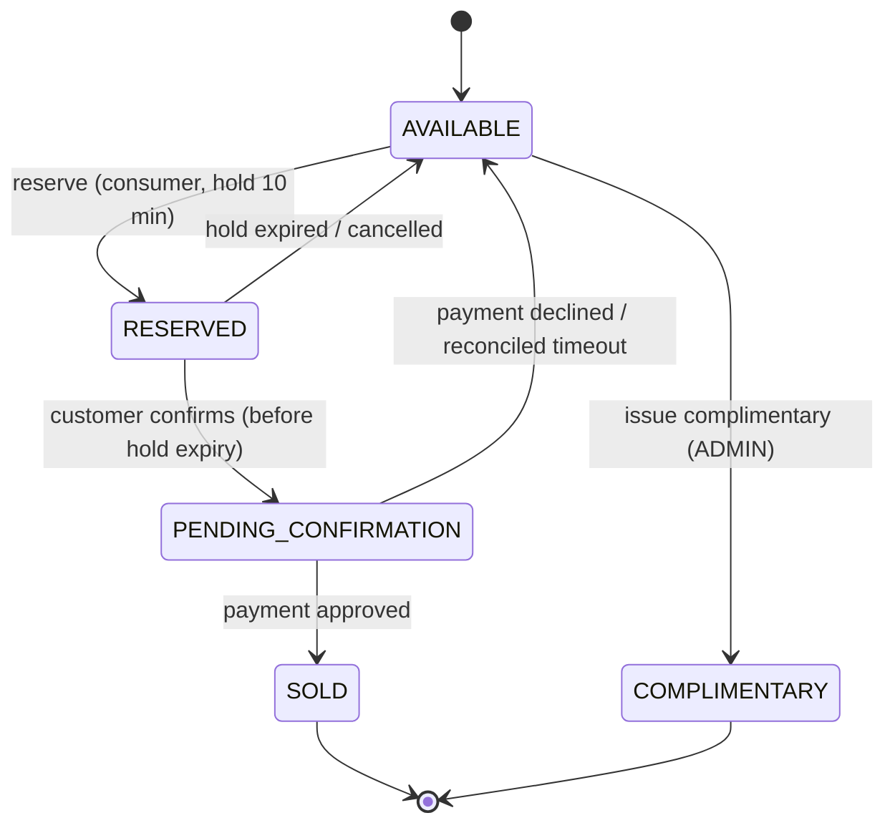

# Plan de implementación — `ms-ticket`
### Plataforma reactiva de procesamiento de eventos de ticketing

> Paquete base: **`com.ticketing`** (se omite cualquier naming de empresa).
> Jerarquía de carpetas y reglas de dependencia: según `prompt-jerarquia-carpetas.md`.
> Todo el código, nombres y comentarios van en **inglés**; la documentación de apoyo puede ir en español.

---

## 0. Resumen de la solución

| Problema actual | Respuesta de diseño |
|---|---|
| Picos de demanda / timeouts | API WebFlux no bloqueante que **solo acepta y encola** (202 + `orderId`); el trabajo pesado lo hacen consumidores SQS con concurrencia acotada (*load leveling*). |
| Asientos vendidos a varias personas | Cada entrada es un ítem en DynamoDB con su estado; toda transición usa **conditional writes** dentro de `TransactWriteItems` (`status = :expected`). |
| Sobreventa | El contador de inventario del evento se decrementa con condición `availableCount >= :qty` **en la misma transacción** que las entradas. |
| Compras duplicadas | `Idempotency-Key` obligatorio → `orderId` determinístico (UUIDv5 de `customerId + key`) + `attribute_not_exists(orderId)`; consumidores idempotentes (at-least-once). |
| Reservas colgadas | Hold de 10 min con `holdExpiresAt`; *sweeper* periódico con lease distribuido que libera vía conditional writes. |

Stack: **Java 25 · Spring Boot 4.x · WebFlux · AWS SDK v2 async (Netty) · DynamoDB Local · SQS (LocalStack) · Docker · Terraform · JUnit 5 / Mockito / reactor-test / ArchUnit / Testcontainers · JaCoCo ≥ 90 %**.

---

## 1. Modelo de dominio

### 1.1 Máquina de estados de la entrada (`TicketStatusEnum`)



- Transiciones válidas codificadas en el enum (`canTransitionTo`) y validadas en `domain/inventory/TicketStateMachine` con *pattern matching* (`switch` sobre records sellados).
- `SOLD` y `COMPLIMENTARY` finales (cualquier intento → `InvalidTicketTransitionException`).
- `RESERVED`/`PENDING_CONFIRMATION` no cuentan como venta; `COMPLIMENTARY` es final pero **no contable** (contador separado `complimentaryCount`, excluido de reportes contables).
- **Atómicas y auditables**: cada transición escribe un ítem en `ticket_transitions` (from, to, orderId, reason, actor, timestamp) dentro de la **misma** transacción DynamoDB.

### 1.2 Estado de la orden
El requisito 4 pide consultar la orden con los estados de la entrada. Una orden además necesita expresar “encolada” o “rechazada”, por eso la respuesta expone dos campos (decisión a defender en la reunión):

| Campo | Tipo | Ejemplos |
|---|---|---|
| `status` | `TicketStatusEnum` (requisito literal) | `AVAILABLE` (encolada / nada retenido / liberada), `RESERVED`, `PENDING_CONFIRMATION`, `SOLD`, `COMPLIMENTARY` |
| `processingStatus` | `OrderProcessingStatusEnum` | `QUEUED`, `ACTIVE`, `COMPLETED`, `REJECTED`, `EXPIRED`, `CANCELLED`, `PAYMENT_DECLINED`, `FAILED` |
| `reason` | `String` | `SOLD_OUT`, `HOLD_EXPIRED`, `EVENT_CLOSED`… |

### 1.3 Tablas DynamoDB (single-purpose tables, on-demand)

| Tabla | PK / SK | Atributos clave | Índices |
|---|---|---|---|
| `events` | `eventId` | name, venue, eventDate, totalCapacity, **availableCount, reservedCount, pendingCount, soldCount, complimentaryCount**, status, version | GSI `status-eventDate-index` |
| `tickets` | `eventId` / `ticketId` | status, orderId, holdExpiresAt, `statusKey` (`AVAILABLE#000123`), version | GSI `eventId-statusKey-index` (selección de libres) |
| `orders` | `orderId` | eventId, customerId, type, quantity, ticketIds, status, processingStatus, requestHash, holdExpiresAt, **`deadlineShard` + `deadlineAt` (sparse)**, version | GSI `deadline-index` (sweeper), GSI `customerId-createdAt-index` |
| `ticket_transitions` | `ticketKey` / `occurredAt#transitionId` | from, to, orderId, reason, actor | — |
| `distributed_locks` | `lockName` | owner, leaseUntil (TTL) | — |
| `schema_migrations` | `migrationId` | appliedAt, checksum | — (solo local/ci) |

- **Índice de deadlines “sparse”**: `deadlineAt` solo existe mientras la orden necesita acción futura: `QUEUED` (re-publicar si quedó sin encolar), `RESERVED` (expira hold), `PENDING_CONFIRMATION` (conciliar pago). Se elimina al llegar a estado terminal → el sweeper consulta solo lo necesario. `deadlineShard` (0..N-1) evita una partición caliente en el GSI.
- Entradas **pre-generadas** al crear el evento (`Flux.range` → `BatchWriteItem` de 25 con reintento de `UnprocessedItems`); el evento pasa `PUBLISHING → ON_SALE`. Límite de capacidad configurable (p.ej. 20 000) documentado como limitación.

---

## 2. Flujos principales

### 2.1 Compra (aceptación → reserva → confirmación → pago)

```mermaid
sequenceDiagram
    autonumber
    actor C as Customer
    participant API as API (WebFlux)
    participant DDB as DynamoDB
    participant QR as SQS order-reservation
    participant W as Worker
    participant QP as SQS order-payment
    participant PG as Payment Gateway (mock)

    C->>API: POST /events/{id}/orders (JWT, Idempotency-Key)
    API->>API: validate + rate limit + soft availability check (cache)
    API->>DDB: PutItem order QUEUED (attribute_not_exists, orderId = UUIDv5)
    API->>QR: SendMessage(OrderReservationMessage)
    API-->>C: 202 {orderId, status: AVAILABLE, processingStatus: QUEUED}
    QR->>W: ReceiveMessage (long polling)
    W->>DDB: TransactWriteItems [event available>=qty, tickets status=AVAILABLE, order QUEUED, audit]
    alt success
        W->>QR: DeleteMessage (ack)
    else event condition failed (sold out)
        W->>DDB: order REJECTED(SOLD_OUT); ack
    else ticket condition / TransactionConflict
        W->>W: retry with backoff + jitter (fresh selection)
    end
    C->>API: GET /orders/{id}  → RESERVED, holdExpiresAt
    C->>API: POST /orders/{id}/confirmation (paymentToken)
    API->>DDB: Tx RESERVED→PENDING_CONFIRMATION (holdExpiresAt > now, owner = caller)
    API->>QP: SendMessage(PaymentRequestedMessage)
    API-->>C: 202 PENDING_CONFIRMATION
    QP->>W: ReceiveMessage
    W->>PG: charge (idempotency key = orderId, timeout + circuit breaker)
    W->>DDB: Tx PENDING_CONFIRMATION→SOLD (counters pending-- sold++, audit)
    C->>API: GET /orders/{id} → SOLD
```

### 2.2 Liberación de reservas expiradas
1. `ReservationExpirationSchedulerController` dispara cada `N` s (`Flux.interval`).
2. `ReleaseExpiredReservationsUseCase` adquiere un **lease** en `distributed_locks` (conditional write `leaseUntil < now`) → solo una instancia barre (las demás saltan el ciclo). Aun sin lease el proceso sería seguro porque todo es condicional; el lease evita trabajo duplicado.
3. Query a `deadline-index` (`deadlineAt <= now`, por shard) y por estado:
   - `RESERVED` → Tx `RESERVED→AVAILABLE` con condición `status = RESERVED AND orderId = :o AND holdExpiresAt < :now` (si el cliente confirmó en el mismo instante, solo una de las dos transacciones gana).
   - `PENDING_CONFIRMATION` → **no se libera a ciegas**: se consulta el estado del pago al gateway; si fue capturado → `SOLD`, si no → se anula y se libera (evita cobrar sin entregar entrada).
   - `QUEUED` antigua → se re-publica en SQS (outbox “lite”, el consumidor es idempotente).

### 2.3 Disponibilidad en tiempo real
- `GET /events/{id}/availability` → `Mono` con los contadores (lectura fuertemente consistente).
- `GET /events/{id}/availability/stream` → `Flux<ServerSentEvent>`: polling reactivo cada 1 s + `distinctUntilChanged()`, cancelación al desconectarse el cliente. (En producción: DynamoDB Streams → push; ver §9).

### 2.4 Endpoints

| Método | Ruta | Rol | Respuesta |
|---|---|---|---|
| POST | `/api/v1/events` | ADMIN | 201 `EventResponseDto` |
| GET | `/api/v1/events?status=ON_SALE&limit=&cursor=` | any | 200 `Flux` paginado |
| GET | `/api/v1/events/{eventId}` | any | 200 (cache Caffeine) |
| GET | `/api/v1/events/{eventId}/availability` | any | 200 |
| GET | `/api/v1/events/{eventId}/availability/stream` | any | SSE |
| POST | `/api/v1/events/{eventId}/orders` | CUSTOMER | 202 + `Location` (requiere `Idempotency-Key`) |
| GET | `/api/v1/orders/{orderId}` | owner / ADMIN | 200 |
| POST | `/api/v1/orders/{orderId}/confirmation` | owner | 202 (requiere `Idempotency-Key`) |
| DELETE | `/api/v1/orders/{orderId}/reservation` | owner | 202 (cancelación voluntaria) |
| POST | `/api/v1/events/{eventId}/complimentary-tickets` | ADMIN | 202 |
| GET | `/actuator/health`, `/actuator/prometheus` | infra | — |

Errores: **RFC 9457 `ProblemDetail`** con `errorCode` (`ErrorCodeEnum`), sin stack traces. `409 SOLD_OUT`, `410 HOLD_EXPIRED`, `422 IDEMPOTENCY_KEY_REUSED`, `429` con `Retry-After`.

---

## 3. Decisiones técnicas clave (ADRs a documentar en `docs/adr/`)

1. **ADR-001 Arquitectura en capas según la jerarquía del proyecto** (equivalente a Clean Architecture: `presentation` = adaptadores de entrada; `business.usecase` = casos de uso; `domain` = núcleo; `persistence`/`client`/`cache` = adaptadores de salida; `config` = composition root).
2. **ADR-002 DynamoDB + conditional writes/transacciones** en vez de locks pesimistas: sin bloqueo, escala horizontal, condición atómica server-side. Trade-off: contención en el ítem del evento → retry con backoff+jitter; mejora futura: *sharded counters*.
3. **ADR-003 SQS Standard (at-least-once) + consumidores idempotentes** en vez de FIFO: mayor throughput; la idempotencia se garantiza por condiciones de estado (`processingStatus = QUEUED`). FIFO con `MessageGroupId = eventId` se discute como alternativa (serializa por evento, menos conflictos, menos throughput).
   Config: long polling 20 s, visibility timeout 60 s, `maxReceiveCount = 5` → DLQ (retención 14 días), SSE habilitado.
4. **ADR-004 Consumidor SQS reactivo propio** (`SqsListenerContainer` con `SqsAsyncClient` + `Flux.repeat` + `flatMap(concurrency)`) en vez de Spring Cloud AWS: control explícito de backpressure, ack solo tras éxito, *graceful shutdown* (SmartLifecycle drena in-flight) y sin depender de la compatibilidad de Spring Cloud AWS con Boot 4.
5. **ADR-005 Idempotencia por `orderId` determinístico** (UUIDv5) + `requestHash`: sin tabla extra ni estado `IN_PROGRESS`; mismo key + otro payload → 422. Confirmación idempotente por condición de estado.
6. **ADR-006 Dual-write (DynamoDB + SQS)**: local → re-publicación de órdenes `QUEUED` vencidas por el sweeper; producción → *transactional outbox* con DynamoDB Streams + EventBridge Pipes.
7. **ADR-007 Seguridad**: OAuth2 Resource Server JWT (local: `mock-oauth2-server`; prod: Cognito). `customerId` sale del `sub` del token, nunca del body (anti-spoofing / IDOR).
8. **ADR-008 Runtime modes**: misma imagen con `ticketing.runtime.mode = all | api | worker` → en AWS se despliegan dos servicios ECS con escalado independiente (API por CPU/requests, worker por *backlog per task* de SQS).
9. **ADR-009 Virtual Threads**: no se usan en el request path (WebFlux ya es no bloqueante, mezclarlos no aporta); se habilitan solo para el executor de tareas programadas/bloqueantes residuales. Se justifica honestamente en la reunión.
10. **Java 25 moderno**: records (DTOs, data, commands), sealed interfaces (`ReservationOutcome`, `PaymentOutcome`), pattern matching en `switch` con record patterns, variables sin nombre `_`, *flexible constructor bodies* para validación.

---

## 4. Seguridad

| Amenaza | Mitigación |
|---|---|
| Secretos en código | Cero credenciales hardcodeadas; local: `.env` (no versionado, `.env.example` con dummies de LocalStack); AWS: IAM task roles (sin access keys), Secrets Manager para secretos; *DefaultCredentialsProvider*. |
| Reintentos maliciosos / doble click | `Idempotency-Key` obligatorio (UUID validado), orderId determinístico, consumidores idempotentes, idempotency key también hacia el payment gateway. |
| Abuso de recursos / bots / scalping | Rate limit por `customerId` + IP (Bucket4j en memoria local; WAF rate-based rules / API Gateway throttling en AWS); `quantity` 1..10; límite de órdenes activas por cliente/evento; *soft check* que corta con 409 si el evento está agotado (evita inundar la cola); límite de tamaño de body. |
| IDOR | `GET/confirm/cancel` verifican `order.customerId == token.sub` (condición en el write). |
| Mensajes envenenados | Validación de esquema del mensaje, DLQ + alarma, nunca reintento infinito. |
| Datos en reposo/tránsito | DynamoDB y SQS con KMS, políticas de cola que niegan tráfico no TLS (`aws:SecureTransport`), VPC endpoints. |
| Contenedor | Imagen JRE mínima, usuario no root, filesystem read-only, escaneo (Trivy) en CI. |
| Fugas de info | `ProblemDetail` genérico, logs estructurados sin PII ni tokens. |

---

## 5. Estructura de carpetas y archivos (siguiendo `prompt-jerarquia-carpetas.md`)

> Regla 6: interfaz en el paquete padre, implementación en `impl/` con sufijo `Impl`.
> Las subcarpetas `channel/` y `provider/` de `business/usecase` solo se crean si aparecen variantes reales (YAGNI); hoy no las hay.

### 5.1 Código principal — `src/main/java/com/ticketing/`

```
com/ticketing/
├── TicketingApplication.java
│
├── presentation/                                   # Adaptadores de entrada (REST, SQS, scheduler)
│   ├── EventRestController.java
│   ├── AvailabilityRestController.java
│   ├── OrderRestController.java
│   ├── ComplimentaryRestController.java
│   ├── OrderReservationSqsController.java          # canal SQS: consume order-reservation
│   ├── OrderPaymentSqsController.java              # canal SQS: consume order-payment
│   ├── ReservationExpirationSchedulerController.java
│   ├── impl/
│   │   ├── EventRestControllerImpl.java
│   │   ├── AvailabilityRestControllerImpl.java
│   │   ├── OrderRestControllerImpl.java
│   │   ├── ComplimentaryRestControllerImpl.java
│   │   ├── OrderReservationSqsControllerImpl.java
│   │   ├── OrderPaymentSqsControllerImpl.java
│   │   ├── ReservationExpirationSchedulerControllerImpl.java
│   │   ├── error/GlobalErrorHandler.java           # excepciones → ProblemDetail
│   │   └── idempotency/
│   │       ├── IdempotencyKeyResolver.java         # extrae/valida header Idempotency-Key
│   │       └── RequestFingerprintCalculator.java   # hash canónico del body
│   ├── dto/
│   │   ├── CreateEventRequestDto.java
│   │   ├── EventResponseDto.java
│   │   ├── AvailabilityResponseDto.java
│   │   ├── PlaceOrderRequestDto.java
│   │   ├── OrderAcceptedResponseDto.java
│   │   ├── OrderStatusResponseDto.java
│   │   ├── ConfirmOrderRequestDto.java
│   │   ├── IssueComplimentaryRequestDto.java
│   │   ├── PageResponseDto.java
│   │   └── message/
│   │       ├── OrderReservationMessageRequestDto.java
│   │       └── PaymentRequestedMessageRequestDto.java
│   ├── mapper/
│   │   ├── EventDtoMapper.java
│   │   ├── AvailabilityDtoMapper.java
│   │   ├── OrderDtoMapper.java
│   │   └── OrderMessageDtoMapper.java
│   └── context/
│       ├── RequestContext.java                     # record: customerId, roles, correlationId, clientIp
│       ├── RequestContextResolver.java
│       └── impl/RequestContextResolverImpl.java    # ReactiveSecurityContextHolder + headers
│
├── business/
│   └── usecase/
│       ├── CreateEventUseCase.java
│       ├── GetEventUseCase.java
│       ├── ListEventsUseCase.java
│       ├── GetEventAvailabilityUseCase.java
│       ├── StreamEventAvailabilityUseCase.java
│       ├── PlaceOrderUseCase.java
│       ├── GetOrderStatusUseCase.java
│       ├── ConfirmOrderUseCase.java
│       ├── CancelOrderUseCase.java
│       ├── IssueComplimentaryTicketsUseCase.java
│       ├── ReserveTicketsUseCase.java
│       ├── ProcessOrderPaymentUseCase.java
│       ├── ReleaseExpiredReservationsUseCase.java
│       ├── RepublishStaleOrdersUseCase.java
│       └── impl/
│           ├── event/
│           │   ├── CreateEventUseCaseImpl.java
│           │   ├── GetEventUseCaseImpl.java
│           │   ├── ListEventsUseCaseImpl.java
│           │   ├── GetEventAvailabilityUseCaseImpl.java
│           │   └── StreamEventAvailabilityUseCaseImpl.java
│           ├── order/
│           │   ├── PlaceOrderUseCaseImpl.java
│           │   ├── GetOrderStatusUseCaseImpl.java
│           │   ├── ConfirmOrderUseCaseImpl.java
│           │   ├── CancelOrderUseCaseImpl.java
│           │   └── IssueComplimentaryTicketsUseCaseImpl.java
│           └── inventory/
│               ├── ReserveTicketsUseCaseImpl.java
│               ├── ProcessOrderPaymentUseCaseImpl.java
│               ├── ReleaseExpiredReservationsUseCaseImpl.java
│               └── RepublishStaleOrdersUseCaseImpl.java
│
├── domain/                                         # Sin dependencias (solo java.* y enums)
│   ├── data/
│   │   ├── EventData.java
│   │   ├── TicketData.java
│   │   ├── OrderData.java
│   │   ├── TicketTransitionData.java
│   │   ├── AvailabilitySnapshot.java
│   │   └── PageData.java
│   ├── internal_request/
│   │   ├── CreateEventRequest.java
│   │   ├── PlaceOrderRequest.java
│   │   ├── ConfirmOrderRequest.java
│   │   ├── CancelOrderRequest.java
│   │   ├── IssueComplimentaryRequest.java
│   │   ├── ReserveTicketsRequest.java
│   │   ├── ProcessOrderPaymentRequest.java
│   │   ├── OrderReservationMessage.java            # contrato hacia client (cola)
│   │   └── PaymentRequestedMessage.java
│   ├── external_request/payment/
│   │   ├── PaymentChargeRequest.java
│   │   ├── PaymentChargeResponse.java
│   │   └── PaymentStatusResponse.java
│   ├── exception/
│   │   ├── TicketingException.java                 # base abstracta con ErrorCodeEnum
│   │   ├── EventNotFoundException.java
│   │   ├── OrderNotFoundException.java
│   │   ├── InsufficientInventoryException.java
│   │   ├── InvalidTicketTransitionException.java
│   │   ├── ReservationExpiredException.java
│   │   ├── OrderOwnershipException.java
│   │   ├── IdempotencyKeyConflictException.java
│   │   ├── InventoryConflictException.java         # retryable
│   │   ├── MessagePublishingException.java
│   │   └── PaymentGatewayException.java
│   ├── inventory/
│   │   ├── TicketStateMachine.java
│   │   ├── ReserveInventoryCommand.java
│   │   ├── ConfirmInventoryCommand.java
│   │   ├── FinalizeSaleCommand.java
│   │   ├── ReleaseInventoryCommand.java
│   │   └── ReservationOutcome.java                 # sealed: Reserved | SoldOut | AlreadyProcessed | StaleSelection
│   └── order/
│       ├── OrderDeadlinePolicy.java                # hold 10 min, confirm timeout, republish window
│       └── PaymentOutcome.java                     # sealed: Approved | Declined | Unknown
│
├── persistence/
│   ├── EventPersistence.java
│   ├── TicketPersistence.java
│   ├── OrderPersistence.java
│   ├── InventoryTransactionPersistence.java        # reserve / confirm / finalize / release / complimentary (TransactWriteItems)
│   ├── TicketTransitionPersistence.java
│   ├── DistributedLockPersistence.java
│   ├── impl/
│   │   ├── EventPersistenceImpl.java
│   │   ├── TicketPersistenceImpl.java
│   │   ├── OrderPersistenceImpl.java
│   │   ├── InventoryTransactionPersistenceImpl.java
│   │   ├── TicketTransitionPersistenceImpl.java
│   │   ├── DistributedLockPersistenceImpl.java
│   │   ├── mapper/{Event,Ticket,Order,TicketTransition}EntityMapper.java
│   │   └── support/TransactionCancellationTranslator.java   # CancellationReasons → ReservationOutcome
│   ├── entity/
│   │   ├── EventEntity.java
│   │   ├── TicketEntity.java
│   │   ├── OrderEntity.java
│   │   ├── TicketTransitionEntity.java
│   │   └── DistributedLockEntity.java
│   └── dto/
│       ├── EventCountersDto.java
│       ├── AvailableTicketDto.java
│       └── DueOrderDto.java                        # proyección del deadline-index
│
├── client/
│   ├── rest/
│   │   ├── api/PaymentGatewayChargeApi.java
│   │   └── impl/PaymentGatewayChargeClientImpl.java          # WebClient + timeout + circuit breaker
│   ├── sdk/
│   │   ├── SqsOrderQueueClient.java
│   │   └── impl/SqsOrderQueueClientImpl.java                 # SqsAsyncClient, atributos traceparent/correlationId
│   ├── mapper/
│   │   ├── PaymentGatewayChargeClientMapper.java
│   │   └── SqsOrderQueueClientMapper.java
│   └── dto/
│       ├── payment/{ChargeRequestDto,ChargeResponseDto,PaymentStatusDto}.java
│       └── sqs/{OrderReservationMessageDto,PaymentRequestedMessageDto}.java
│
├── cache/
│   ├── EventCacheService.java
│   └── impl/EventCacheServiceImpl.java             # Caffeine AsyncCache (TTL corto)
│
├── config/
│   ├── properties/TicketingProperties.java         # @ConfigurationProperties record (holdTtl, maxTicketsPerOrder…)
│   ├── aws/AwsClientConfig.java                    # DynamoDbAsyncClient, SqsAsyncClient (endpoint override local)
│   ├── aws/AwsProperties.java
│   ├── dynamodb/DynamoDbConfig.java                # Enhanced async client + TableSchemas
│   ├── migration/DynamoMigrationRunner.java        # aplica db/changelog (solo local/ci)
│   ├── migration/MigrationChangelogReader.java
│   ├── messaging/SqsListenerContainer.java         # poller reactivo genérico + ack/nack + graceful shutdown
│   ├── messaging/SqsListenerConfig.java
│   ├── messaging/SqsQueueProperties.java
│   ├── security/SecurityConfig.java                # SecurityWebFilterChain, JWT resource server
│   ├── security/JwtRoleConverter.java
│   ├── web/WebFluxConfig.java                      # codecs, límites de body
│   ├── web/CorrelationIdWebFilter.java
│   ├── ratelimit/RateLimitConfig.java
│   ├── ratelimit/RateLimitWebFilter.java
│   ├── resilience/ResilienceConfig.java            # CircuitBreaker (resilience4j-reactor), timeouts
│   ├── scheduling/SchedulingConfig.java
│   ├── observability/ObservabilityConfig.java      # common tags, métricas custom
│   └── time/ClockConfig.java                       # java.time.Clock inyectable (tests deterministas)
│
├── enums/
│   ├── TicketStatusEnum.java
│   ├── OrderProcessingStatusEnum.java
│   ├── OrderTypeEnum.java                          # STANDARD, COMPLIMENTARY
│   ├── EventStatusEnum.java                        # PUBLISHING, ON_SALE, CLOSED
│   ├── TransitionReasonEnum.java
│   ├── MessageTypeEnum.java
│   ├── RuntimeModeEnum.java                        # ALL, API, WORKER
│   └── ErrorCodeEnum.java
│
└── util/
    ├── DeterministicIdUtil.java                    # UUIDv5 (customerId + idempotencyKey)
    ├── HashUtil.java                               # SHA-256 de requests
    └── ReactiveRetryUtil.java                      # Retry.backoff + jitter + filtro de retryables
```

### 5.2 Recursos — `src/main/resources/`

```
resources/
├── application.yml
├── application-local.yml
├── application-dev.yml
├── application-ci.yml
├── application-prod.yml
├── db/changelog/db.changelog-master.yaml           # lista ordenada de migraciones
├── db/migrations/
│   ├── 20261010100000_TCK-001/create-events-table.json
│   ├── 20261010100100_TCK-002/create-tickets-table.json
│   ├── 20261010100200_TCK-003/create-orders-table.json
│   ├── 20261010100300_TCK-004/create-ticket-transitions-table.json
│   └── 20261010100400_TCK-005/create-distributed-locks-table.json
├── scripts/localstack/init-sqs.sh                  # colas + DLQ + redrive policy
└── templates/messages/
    ├── order-reservation-message.schema.json
    └── payment-requested-message.schema.json
```
> Regla 7: cada cambio de esquema = nueva carpeta en `db/migrations` registrada en el changelog. En AWS el esquema lo gobierna Terraform (mismas definiciones); el runner solo corre con perfiles `local`/`ci`.

### 5.3 Tests — espejo exacto (regla 8)

```
src/test/java/com/ticketing/                        # unitarios (JUnit 5 + Mockito + reactor-test)
├── architecture/                                   # ÚNICO paquete sin espejo: reglas ArchUnit (§6)
├── presentation/   (…ControllerImplTest con WebTestClient, mappers, context, idempotency, error)
├── business/usecase/impl/{event,order,inventory}/  (…UseCaseImplTest + *ConcurrencyTest)
├── domain/         (TicketStateMachineTest, OrderDeadlinePolicyTest, records con validación)
├── persistence/impl/ (…PersistenceImplTest con DynamoDbAsyncClient mockeado, translators, mappers)
├── client/         (SqsOrderQueueClientImplTest, PaymentGatewayChargeClientImplTest con MockWebServer)
├── cache/impl/     (EventCacheServiceImplTest)
├── config/         (SqsListenerContainerTest, RateLimitWebFilterTest, JwtRoleConverterTest…)
├── enums/          (TicketStatusEnumTest: matriz completa de transiciones)
└── util/           (DeterministicIdUtilTest, HashUtilTest, ReactiveRetryUtilTest)

src/integrationTest/java/com/ticketing/             # *IT con Testcontainers (DynamoDB Local + LocalStack)
├── persistence/impl/InventoryTransactionPersistenceImplIT.java
├── client/sdk/impl/SqsOrderQueueClientImplIT.java
└── presentation/OrderPurchaseFlowIT.java           # E2E: place → reserve → confirm → SOLD
```

---

## 6. Reglas de arquitectura como tests (ArchUnit)

`src/test/java/com/ticketing/architecture/`:

| Test | Regla que hace cumplir |
|---|---|
| `LayerDependencyRulesTest` | `presentation → business.usecase → (persistence \| client \| cache) → domain`. `presentation` no accede a `persistence`, `client`, `cache` ni a `business..impl`. `business` no usa `presentation..dto`, `persistence.entity`, `client.dto` ni clases `*Impl`. |
| `DomainPurityRulesTest` | `domain` solo depende de `java..`, `domain..` y `enums..` (ni Spring, ni AWS, ni Reactor). |
| `EncapsulationRulesTest` | `persistence.entity` solo se usa dentro de `persistence`; `client.dto` solo dentro de `client`; `presentation.dto` solo dentro de `presentation`. |
| `ImplPlacementRulesTest` | Toda clase `*Impl` vive en un paquete `..impl..` e implementa una interfaz del paquete padre; las interfaces no viven en `impl`. |
| `NamingConventionRulesTest` | Sufijos: `UseCase`, `Persistence`, `Entity`, `Controller`, `RequestDto`/`ResponseDto`, `Mapper`, `Enum`, `Exception`, `Config`, `CacheService`, `Client`/`Api`. |
| `ReactiveRulesTest` | Prohibido `Mono.block*`, `Flux.block*`, `Thread.sleep`, `toFuture().get()` en código de producción. |
| `CycleRulesTest` | Sin ciclos entre slices `com.ticketing.(*)..`. |
| `TestMirrorRulesTest` | Cada clase de producción tiene `<Clase>Test` en el mismo paquete de test (allowlist explícita y documentada solo para records sin lógica: DTOs/entities). |

Cobertura: **JaCoCo** con `jacocoTestCoverageVerification` (LINE ≥ 0.90 y BRANCH ≥ 0.90) enganchado a `check`; exclusiones mínimas (`TicketingApplication`).

### Tests de concurrencia (requisito explícito)
1. `ReserveTicketsUseCaseImplConcurrencyTest`: fake persistence en memoria con CAS atómico; 1 000 reservas concurrentes (`Flux.range().flatMap(…, 256)` sobre `Schedulers.parallel()`) para capacidad 100 → exactamente 100 `RESERVED`, 900 `REJECTED`, ningún ticket asignado dos veces, contadores consistentes.
2. `InventoryTransactionPersistenceImplIT`: lo mismo contra **DynamoDB Local real** (condiciones reales).
3. Carrera *confirmación vs expiración* → exactamente una gana.
4. Entrega duplicada del mismo mensaje SQS → una sola reserva.
5. Misma `Idempotency-Key` concurrente → una sola orden.
6. Retry ante `TransactionConflict` con `StepVerifier.withVirtualTime` (backoff verificado sin esperas reales).

---

## 7. Infraestructura local (Docker)

**`Dockerfile`** multi-stage: `eclipse-temurin:25-jdk` (build Gradle, capas Spring Boot) → `eclipse-temurin:25-jre` (o distroless), usuario no root, `-XX:MaxRAMPercentage=75`, healthcheck vía actuator.

**`docker-compose.yml`**:

| Servicio | Imagen | Rol |
|---|---|---|
| `dynamodb-local` | `amazon/dynamodb-local` | persistencia (`-sharedDb`) |
| `localstack` | `localstack/localstack` (versión fijada) | SQS + init script de colas/DLQ |
| `payment-mock` | `wiremock/wiremock` | gateway de pagos (aprobado / rechazado / lento / 5xx según token) |
| `auth-mock` | `ghcr.io/navikt/mock-oauth2-server` | emisor JWT con JWKS (mismo flujo que Cognito) |
| `ticketing-api` | build local | `runtime.mode=api` |
| `ticketing-worker` | build local | `runtime.mode=worker` (escalable: `--scale ticketing-worker=2`) |
| `dynamodb-admin` (opcional, profile `tools`) | `aaronshaf/dynamodb-admin` | inspección |

`depends_on` con `condition: service_healthy`; variables en `.env` (`.env.example` versionado).
> Riesgo: si la imagen de LocalStack exige auth token en la versión vigente, se reemplaza por **ElasticMQ** (API SQS compatible) sin cambiar código.

Extras: `scripts/curl/flows.sh`, `postman/ms-ticket.postman_collection.json` + `postman/local.postman_environment.json` (obtiene el token del auth-mock y encadena `orderId` entre requests), `load-test/k6/ticket-rush.js` (miles de compras simultáneas sobre un evento de capacidad pequeña y verificación final de **cero sobreventa**).

---

## 8. Terraform (valor diferencial) — `infra/terraform/`

```
infra/terraform/
├── modules/
│   ├── network/        # VPC 3 AZ, subnets públicas/privadas, NAT (1 en dev / 3 en prod),
│   │                   # VPC endpoints: DynamoDB (gateway, gratis), SQS/ECR/Logs/STS/SecretsManager (interface), flow logs
│   ├── dynamodb/       # tablas on-demand, GSIs, PITR, SSE-KMS (CMK), TTL, deletion_protection, contributor insights
│   ├── sqs/            # colas + DLQ, KMS, redrive_policy, policy que niega no-TLS, alarmas DLQ/age-of-oldest
│   ├── ecr/            # scan on push, tags inmutables, lifecycle
│   ├── alb_waf/        # ALB HTTPS (ACM), WAF: AWS managed rules + rate-based rule por IP
│   ├── ecs_service/    # Fargate, task roles least-privilege por servicio, autoscaling
│   │                   #   api: target tracking CPU/ALBRequestCountPerTarget; worker: backlog-per-task (metric math)
│   ├── auth/           # Cognito user pool + grupos ADMIN/CUSTOMER
│   └── observability/  # log groups (retención + KMS), dashboard, alarmas (5xx, p99, throttles, DLQ>0), SNS
├── envs/
│   ├── dev/  {backend.tf, main.tf, variables.tf, terraform.tfvars}
│   └── prod/ {backend.tf, main.tf, variables.tf, terraform.tfvars}
└── README.md
```
- Estado remoto en S3 (cifrado, versionado, *lockfile* nativo) por entorno → aislamiento de entornos (idealmente cuentas separadas vía AWS Organizations).
- Gobernanza: `default_tags` (Project, Environment, Owner, CostCenter), AWS Budgets, `terraform fmt/validate`, `tflint`, `checkov` en CI.
- Costos: DynamoDB on-demand para picos impredecibles (provisioned + autoscaling si el tráfico se vuelve predecible), transacciones = 2× WCU, Fargate Spot para workers, VPC gateway endpoint en lugar de NAT para DynamoDB, retención de logs acotada.

CI (`.github/workflows/ci.yml`): build + tests + coverage gate + integration tests (Testcontainers) + Trivy + validaciones de Terraform.

---

## 9. Observabilidad, resiliencia y limitaciones (para la reunión)

**Observabilidad**: logs JSON estructurados (Spring Boot structured logging) con `correlationId`/`traceId`; Micrometer + Prometheus; tracing OpenTelemetry propagando `traceparent` en atributos SQS; métricas custom: `orders.placed`, `reservations.result{outcome}`, `inventory.conflict.retries`, `reservations.released`, `payment.result`, lag de cola.

**Resiliencia**: retry con backoff+jitter solo para errores retryables (throttling, `TransactionConflict`, 5xx); timeouts en todas las llamadas externas; circuit breaker hacia el payment gateway; DLQ + alarmas; graceful shutdown que drena mensajes en vuelo; visibilidad SQS > tiempo máximo de procesamiento.

**Limitaciones conocidas y mejoras para producción**:
1. Ítem del evento = **partición caliente** para eventos masivos → *sharded inventory counters* (N shards con fracciones de capacidad).
2. Selección de tickets libres vía GSI (eventualmente consistente) → reintentos; alternativa: asignación de asiento al confirmar.
3. Rate limiter en memoria por instancia → WAF/API Gateway o Redis/ElastiCache.
4. SSE por polling → DynamoDB Streams + API Gateway WebSocket / AppSync.
5. Dual-write mitigado por re-publicación → outbox real con DynamoDB Streams + EventBridge Pipes.
6. Para *drops* masivos: **sala de espera virtual** (CloudFront + token de admisión) antes del API.
7. Multi-región: Global Tables son *last-writer-wins* → el inventario debe tener región “home” para evitar sobreventa.
8. Reportes contables/inventario: exportar `ticket_transitions` vía Streams → S3/Athena.
9. Pago simulado; un proveedor real exige PCI-DSS (tokenización en frontend, nunca PAN en el backend).

---

## 10. Fases de implementación

| # | Fase | Entregables | Criterio de salida |
|---|---|---|---|
| 0 | **Bootstrap** | `settings.gradle.kts`, `build.gradle.kts`, `gradle/libs.versions.toml`, wrapper Gradle 9.x, toolchain 25, `.gitignore`, `.editorconfig`, `git init` | `./gradlew build` en verde; matriz de compatibilidad verificada (Boot 4.x, AWS SDK v2, JaCoCo ≥ 0.8.14, ArchUnit, Mockito como `-javaagent`, Testcontainers 2.x) |
| 1 | **Tests de arquitectura primero** | paquete `architecture/` + JaCoCo gate | Reglas activas desde el día 1 (fallan si alguien rompe capas) |
| 2 | **Domain + enums** | máquina de estados, commands, outcomes sellados, excepciones | 100 % cobertura de transiciones |
| 3 | **Config base** | properties, Clock, AWS clients, migration runner, perfiles | App levanta contra DynamoDB Local/LocalStack |
| 4 | **Persistence** | entities, mappers, `*PersistenceImpl`, transacciones condicionales, migraciones | Unit tests + `InventoryTransactionPersistenceImplIT` (sin sobreventa) |
| 5 | **Client + cache** | SQS publisher, payment client (WebClient + CB), Caffeine | Tests con MockWebServer/mocks + IT SQS |
| 6 | **Business** | 14 casos de uso | Tests con mocks + StepVerifier + tests de concurrencia |
| 7 | **Presentation** | REST controllers, SSE, idempotency, context, error handler, SQS controllers, scheduler, `SqsListenerContainer` | WebTestClient tests; flujo E2E IT |
| 8 | **Seguridad** | JWT resource server, roles, ownership, rate limit, límites | Tests 401/403/429/422 |
| 9 | **Docker** | Dockerfile, compose, init scripts, WireMock mappings, auth mock | `docker compose up` → flujo completo con Postman |
| 10 | **Colección + carga** | Postman, curl, k6 | k6 demuestra 0 sobreventa bajo carga |
| 11 | **Terraform + CI** | módulos, envs, workflow | `terraform validate` + `checkov` en verde |
| 12 | **Documentación** | `README.md`, `docs/architecture.md` (Mermaid: C4 contexto/contenedores, secuencias, estados), `docs/adr/*` | README cumple todos los puntos del enunciado |

---

## 11. Decisiones tomadas por defecto (confirmar o ajustar)

1. Paquete base `com.ticketing`, artefacto `ms-ticket`.
2. Build con **Gradle (Kotlin DSL)** (alternativa: Maven).
3. DynamoDB Local + LocalStack (SQS); fallback ElasticMQ.
4. Autenticación con JWT real (mock-oauth2-server local / Cognito en AWS) en vez de API keys.
5. Entradas pre-generadas por evento con tope de capacidad configurable.
6. Tests de integración en un source set separado (`integrationTest`) para que `./gradlew test` siga siendo rápido; la cobertura del 90 % se mide sobre los unitarios.
7. ArchUnit en `com.ticketing.architecture` como única excepción al espejo de tests.
