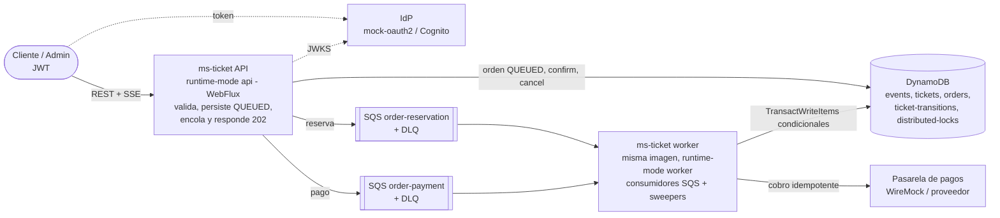

# ms-ticket — Plataforma reactiva de procesamiento de ticketing

Backend reactivo para la venta de entradas de eventos con alta demanda: **Java 25, Spring Boot
4.1.1 WebFlux, DynamoDB, SQS, Docker y Terraform**. Acepta órdenes sin bloquearse en los picos,
garantiza **cero sobreventa y cero doble asignación** con transacciones condicionales, libera
reservas vencidas automáticamente y deja una auditoría atómica de cada cambio de estado de cada
entrada.

| Problema | Respuesta de diseño |
|---|---|
| Picos de demanda y timeouts | La API **solo valida, persiste y encola** (`202 Accepted` + `orderId`); los workers procesan desde SQS a ritmo controlado (*load leveling*) |
| Una entrada vendida a varias personas | Cada entrada es un ítem con estado; toda transición es una **transacción condicional** de DynamoDB (`status = :esperado`) |
| Sobreventa | El contador del evento se decrementa con `availableCount >= :q` **en la misma transacción** que las entradas y la orden |
| Compras duplicadas | `Idempotency-Key` obligatorio → `orderId` determinístico (UUID v5) + `attribute_not_exists`; consumidores idempotentes; idempotencia también hacia la pasarela |
| Reservas colgadas | Hold de 10 min; *sweeper* con lease distribuido que libera vencidas y concilia pagos |

> Documentación: [arquitectura](docs/architecture.md) · [ADRs](docs/adr/README.md) ·
> [seguridad](docs/security.md) · [operación](docs/operations.md) ·
> [limitaciones y mejoras](docs/limitations-and-improvements.md) ·
> [especificación](docs/design/implementation-spec.md) ·
> [guía de la presentación](docs/presentation-guide.md) ·
> [evidencia E2E](docs/testing/e2e-evidence.md) · [infra local](docker/README.md) ·
> [Terraform](infra/terraform/README.md)

---

## Índice

1. [Arquitectura en una imagen](#1-arquitectura-en-una-imagen)
2. [Stack](#2-stack)
3. [Requisitos previos](#3-requisitos-previos)
4. [Instalación y configuración](#4-instalación-y-configuración)
5. [Levantar con Docker](#5-levantar-con-docker)
6. [Ejecutar sin Docker (solo la aplicación)](#6-ejecutar-sin-docker-solo-la-aplicación)
7. [Tests y calidad](#7-tests-y-calidad)
8. [Obtener tokens](#8-obtener-tokens)
9. [Uso de la API con ejemplos reales](#9-uso-de-la-api-con-ejemplos-reales)
10. [Colección Postman y newman](#10-colección-postman-y-newman)
11. [Prueba de carga k6](#11-prueba-de-carga-k6)
12. [Decisiones arquitectónicas](#12-decisiones-arquitectónicas)
13. [Estructura de carpetas](#13-estructura-de-carpetas)
14. [Seguridad](#14-seguridad)
15. [Infraestructura como código (Terraform)](#15-infraestructura-como-código-terraform)
16. [Limitaciones y mejoras](#16-limitaciones-y-mejoras)
17. [Mapa requisito → dónde se cumple](#17-mapa-requisito--dónde-se-cumple)

---

## 1. Arquitectura en una imagen



Flujo de una compra: `POST /orders` → orden `QUEUED` (202) → el worker **reserva** con una
transacción (entradas `RESERVED`, hold 10 min) → el cliente **confirma** (`PENDING_CONFIRMATION`) →
el worker **cobra** (`Idempotency-Key = orderId`) → `SOLD`, o libera si el pago es rechazado. Un
*sweeper* libera holds vencidos y concilia pagos sin respuesta. Diagramas C4, de estados y de
secuencia (compra, carreras, rechazo, sweeper, outbox, SSE) en [docs/architecture.md](docs/architecture.md).

## 2. Stack

| Ámbito | Tecnología |
|---|---|
| Lenguaje y build | Java 25 (toolchain de Gradle), Gradle 9.8.1 (Kotlin DSL), `javac -Werror` |
| Framework | Spring Boot 4.1.1, Spring WebFlux (Reactor Netty), Spring Security 7 (OAuth2 Resource Server), Actuator + Micrometer/Prometheus, Jackson 3 |
| Datos | Amazon DynamoDB (AWS SDK v2 asíncrono sobre Netty, cliente *enhanced* para lecturas tipadas) |
| Mensajería | Amazon SQS Standard + DLQ, consumidor reactivo propio (`SqsListenerContainer`) |
| Resiliencia | Resilience4j (circuit breaker), reintentos con backoff + jitter de Reactor, Bucket4j (rate limit), Caffeine (caché) |
| Tests | JUnit 5, Mockito, reactor-test (`StepVerifier`), AssertJ, ArchUnit 1.5.1, MockWebServer, Testcontainers 2.0.5, JaCoCo 0.8.15 |
| Local | Docker Compose: DynamoDB Local 3.3.1, LocalStack 4.9 (SQS), WireMock 3.13.2 (pagos), mock-oauth2-server 6.0.5 (JWT) |
| Nube | Terraform: ECS Fargate (api/worker), DynamoDB, SQS, ALB + WAF, Cognito, KMS, CloudWatch, VPC endpoints |
| Calidad | Postman/newman, k6, GitHub Actions (`.github/workflows/ci.yml`) |

## 3. Requisitos previos

| Herramienta | Para qué | Notas |
|---|---|---|
| Docker Desktop / Engine 25+ con Compose v2 | levantar el stack y los tests de integración | `docker compose up --wait` y `start_interval` en healthchecks |
| JDK 25 | tests y ejecución sin Docker | Gradle lo detecta (o lo descarga con el *foojay resolver*); el wrapper `./gradlew` trae Gradle |
| bash + curl (Git Bash en Windows) | `scripts/infra/*.sh`, `scripts/curl/flows.sh` | `jq` opcional |
| Node.js 18+ | `npx newman` (colección Postman) | opcional |
| k6 o Docker | prueba de carga (`grafana/k6`) | opcional |
| Terraform ≥ 1.10 (o Docker) | validar la IaC | opcional, sin credenciales AWS |

Puertos locales (solo en `127.0.0.1`): `8080` API, `8000` DynamoDB Local, `4566` LocalStack, `8089`
pagos, `8090` auth, `8001` dynamodb-admin (opcional). Se cambian en `.env` (`*_HOST_PORT`).

## 4. Instalación y configuración

```bash
git clone <repo> ms-ticket && cd ms-ticket
cp .env.example .env          # valores dummy para los emuladores (git-ignored)
```

Variables de `.env` (ver `.env.example`):

| Variable | Valor por defecto | Uso |
|---|---|---|
| `LOCAL_AWS_REGION`, `LOCAL_AWS_ACCESS_KEY_ID`, `LOCAL_AWS_SECRET_ACCESS_KEY` | `us-east-1`, `test`, `test` | credenciales **dummy** de DynamoDB Local/LocalStack, inyectadas como `AWS_*` solo dentro de los contenedores (el prefijo `LOCAL_` evita reenviar credenciales reales exportadas en tu shell) |
| `SQS_ORDER_RESERVATION_QUEUE`, `SQS_ORDER_PAYMENT_QUEUE` | `ticketing-order-reservation`, `ticketing-order-payment` | nombres de cola (cada una con `<cola>-dlq`) |
| `API_HOST_PORT`, `AUTH_MOCK_HOST_PORT`, `PAYMENT_MOCK_HOST_PORT`, `DYNAMODB_HOST_PORT`, `LOCALSTACK_HOST_PORT`, `DYNAMODB_ADMIN_HOST_PORT` | 8080, 8090, 8089, 8000, 4566, 8001 | puertos del host |

Configuración de la aplicación: `src/main/resources/application.yml` (valores comunes) y perfiles
`application-{local,ci,dev,prod}.yml`. Propiedades principales (todas sobreescribibles por variables
de entorno con *relaxed binding*, p. ej. `TICKETING_ORDERS_HOLDTTL=30s`):

| Propiedad | Defecto | Descripción |
|---|---|---|
| `ticketing.runtime-mode` | `all` | `all`, `api` o `worker` ([ADR-0008](docs/adr/0008-runtime-modes.md)) |
| `ticketing.orders.hold-ttl` / `confirmation-timeout` | `10m` / `5m` | duración del hold y plazo del pago |
| `ticketing.orders.max-tickets-per-order` / `max-complimentary-per-request` | `10` / `40` | límites por orden |
| `ticketing.events.max-capacity` | `20000` | capacidad máxima por evento |
| `ticketing.sweeper.interval` / `lease` | `15s` / `30s` | ciclo de los sweepers y lease distribuido |
| `ticketing.rate-limit.capacity` / `refill-tokens` / `refill-period` | `20` / `20` / `1s` | rate limit por sujeto (POST/DELETE) |
| `ticketing.messaging.concurrency` / `pollers` / `visibility-timeout-seconds` | `16` / `2` / `60` | consumidor SQS |
| `ticketing.payment.base-url` | `http://localhost:8089` | pasarela de pagos |
| `ticketing.security.issuer` / `audience` / `roles-claim` | `http://localhost:8090/default` / `ms-ticket` / `roles` | validación del JWT |

No hay ninguna credencial en código ni en YAML: el SDK usa `DefaultCredentialsProvider`
(variables de entorno en local, IAM task role en AWS). Tabla completa en
[docs/architecture.md §10](docs/architecture.md#10-configuración-relevante-valores-por-defecto).

## 5. Levantar con Docker

```bash
docker compose up -d --build --wait     # build de la imagen + stack completo; vuelve cuando todo está sano
docker compose ps                       # 6 servicios "healthy"
scripts/infra/verify-infra.sh           # smoke test: colas + DLQ, tablas, escenarios de pago y tokens
```

| Servicio | Imagen | Rol |
|---|---|---|
| `dynamodb-local` | `amazon/dynamodb-local:3.3.1` | DynamoDB en memoria (`-sharedDb -inMemory`) |
| `localstack` | `localstack/localstack:4.9` | SQS: 2 colas + 2 DLQ creadas por `src/main/resources/scripts/localstack/init-sqs.sh` |
| `payment-mock` | `wiremock/wiremock:3.13.2` | pasarela: `tok_approved*`, `tok_declined*`, `tok_slow*` (5 s), `tok_error*` (500) |
| `auth-mock` | `ghcr.io/navikt/mock-oauth2-server:6.0.5` | emisor JWT + JWKS (clientes `customer-1`, `customer-2`, `admin`) |
| `ticketing-api` | `ms-ticket:local` | `TICKETING_RUNTIMEMODE=API`, puerto 8080, aplica las migraciones DynamoDB |
| `ticketing-worker` | `ms-ticket:local` | `TICKETING_RUNTIMEMODE=WORKER`, consumidores + sweepers, sin puertos publicados |

Verificación de salud:

```bash
curl -s http://localhost:8080/actuator/health/readiness     # {"status":"UP"}
curl -s http://localhost:8080/actuator/prometheus | head    # métricas
docker compose logs -f ticketing-worker                     # reservas, pagos y sweepers
```

Escalar workers (todas las réplicas consumen las mismas colas; los sweepers usan un lease, así que
solo una barre a la vez):

```bash
docker compose up -d --wait --scale ticketing-worker=3
docker compose up -d --wait --scale ticketing-worker=1
```

**Modo demo** (flujos temporales en segundos: hold 30 s, confirmación 20 s, sweeper cada 5 s;
`docker-compose.demo.yml`):

```bash
docker compose -f docker-compose.yml -f docker-compose.demo.yml up -d --wait ticketing-api ticketing-worker
scripts/curl/flows.sh expiry payment-error              # RESERVED -> EXPIRED -> 410 y conciliación de pago
docker compose -f docker-compose.yml up -d --wait ticketing-api ticketing-worker   # volver a los tiempos reales
```

Otros:

```bash
docker compose --profile tools up -d dynamodb-admin    # explorador de tablas en http://localhost:8001
scripts/curl/flows.sh --list                           # recorrido curl de todos los flujos (PASS/FAIL)
docker compose down -v                                 # detener y borrar todo el estado
```

Inspección de colas, DLQ y tablas, y la tabla de tokens de pago: [docker/README.md](docker/README.md).

## 6. Ejecutar sin Docker (solo la aplicación)

La infraestructura sigue en compose; la aplicación corre desde Gradle o el IDE con el perfil
`local` (endpoints `localhost:8000`, `localhost:4566`, `localhost:8089`, `localhost:8090` y
migraciones automáticas):

```bash
docker compose up -d --wait dynamodb-local localstack payment-mock auth-mock
docker compose stop ticketing-api ticketing-worker      # si estaban corriendo (liberan el puerto 8080)

export AWS_ACCESS_KEY_ID=test AWS_SECRET_ACCESS_KEY=test AWS_REGION=us-east-1   # dummies del emulador
SPRING_PROFILES_ACTIVE=local ./gradlew bootRun          # modo "all": API + workers + sweepers en un proceso
```

Variantes: `TICKETING_RUNTIME_MODE=api` o `worker` para un solo rol; `SERVER_PORT=8085` para otro
puerto; `./gradlew bootJar && java -jar build/libs/ms-ticket.jar` con las mismas variables.

## 7. Tests y calidad

```bash
./gradlew test                                   # unitarios + ArchUnit (sin Docker) + reporte JaCoCo
./gradlew jacocoTestCoverageVerification         # umbral LINE y BRANCH >= 90 %
./gradlew integrationTest                        # Testcontainers: DynamoDB Local + LocalStack 4.9 (requiere Docker)
./gradlew check                                  # todo lo anterior
./gradlew test --tests "com.ticketing.architecture.*"   # solo las reglas de arquitectura
```

Resultados actuales (`main` en el commit `29c0be4`, octubre de 2026):

| Suite | Resultado |
|---|---|
| Unitarios (`src/test`) | **1 477 tests, 0 fallos** (≈ 30 s de ejecución) |
| ArchUnit (`com.ticketing.architecture`) | 8 clases, **48 reglas** en verde |
| Cobertura JaCoCo (unitarios) | **líneas 100 %** (3 467/3 467), **ramas 99,9 %** (902/903), instrucciones 99,96 % |
| Integración (`src/integrationTest`, Testcontainers) | **67 tests en 12 clases, 0 fallos** (≈ 52 s) + `OrderPurchaseFlowIT` (flujo E2E completo) |

Reportes: `build/reports/tests/test/index.html`, `build/reports/jacoco/test/html/index.html`,
`build/reports/tests/integrationTest/index.html`.

Pruebas de concurrencia destacadas:

| Test | Qué demuestra |
|---|---|
| `ReserveTicketsUseCaseImplConcurrencyTest` | **1 000 órdenes concurrentes por 100 entradas** → exactamente 100 vendidas, ninguna entrada en dos órdenes, contadores consistentes (repetido 3 veces); el mismo mensaje entregado 10 veces en paralelo reserva una sola vez; confirmación vs expiración en el límite del hold: gana exactamente una; la misma `Idempotency-Key` 50 veces en paralelo crea una sola orden |
| `InventoryTransactionPersistenceImplConcurrencyIT` | **200 órdenes contra 50 entradas en DynamoDB Local real**: se reservan exactamente 50; dos órdenes por la misma entrada → gana una |
| `SqsListenerContainerIT` | contra LocalStack real: ack, re-entrega con backoff y `ApproximateReceiveCount` creciente hasta la DLQ, y apagado ordenado que termina el mensaje en vuelo |
| `SecurityConfigIT` | tokens firmados reales: roles, audiencia/emisor/clave ajenos, token alterado y ausente |

La arquitectura es ejecutable: una dependencia prohibida, un sufijo incorrecto, un `block()` en
código reactivo o una clase sin su test espejo **rompen el build**
([ADR-0013](docs/adr/0013-archunit-enforced-architecture.md), `docs/design/architecture-rules.md`).
CI (`.github/workflows/ci.yml`): `./gradlew check`, imagen Docker + escaneo Trivy, ShellCheck y
validación estática de Terraform.

## 8. Obtener tokens

```bash
ADMIN=$(scripts/infra/get-token.sh admin)            # roles [ADMIN]
C1=$(scripts/infra/get-token.sh customer-1)          # roles [CUSTOMER]
C2=$(scripts/infra/get-token.sh customer-2)          # otro cliente (pruebas anti-IDOR)
scripts/infra/get-token.sh admin --claims            # además imprime el payload decodificado
```

Los tokens duran 3 600 s. Deben pedirse a `http://localhost:8090/default` (la API valida
`iss = http://localhost:8090/default`; un token pedido vía `127.0.0.1` da 401). Llamada cruda:
`curl -s -X POST http://localhost:8090/default/token -d grant_type=client_credentials -d client_id=customer-1 -d client_secret=x -d scope=ms-ticket`.

## 9. Uso de la API con ejemplos reales

Todas las respuestas siguientes fueron **capturadas del stack local** (se omiten las cabeceras de
seguridad comunes: `X-Content-Type-Options`, `X-Frame-Options`, `Content-Security-Policy`,
`Referrer-Policy`, `Cache-Control`). Toda respuesta lleva `X-Correlation-Id` (se puede enviar uno
propio).

| Método | Ruta | Rol | Respuesta |
|---|---|---|---|
| `POST` | `/api/v1/events` | ADMIN | `201` + `Location` |
| `GET` | `/api/v1/events?status=ON_SALE&limit=20&cursor=` | público | `200` página con cursor |
| `GET` | `/api/v1/events/{eventId}` | público | `200` (caché de 2 s) |
| `GET` | `/api/v1/events/{eventId}/availability` | público | `200` (lectura consistente) |
| `GET` | `/api/v1/events/{eventId}/availability/stream` | público | SSE `availability` |
| `GET` | `/api/v1/events/{eventId}/tickets/{ticketId}/transitions` | ADMIN | `200` auditoría |
| `POST` | `/api/v1/events/{eventId}/orders` | CUSTOMER, ADMIN | `202` + `Location` (`Idempotency-Key` obligatorio) |
| `GET` | `/api/v1/orders/{orderId}` | dueño o ADMIN | `200` |
| `POST` | `/api/v1/orders/{orderId}/confirmation` | dueño | `202` (`Idempotency-Key` obligatorio) |
| `DELETE` | `/api/v1/orders/{orderId}/reservation` | dueño | `202` (cancelación) |
| `POST` | `/api/v1/events/{eventId}/complimentary-tickets` | ADMIN | `202` + `Location` (`Idempotency-Key` obligatorio) |
| `GET` | `/actuator/health`, `/actuator/health/{liveness,readiness}`, `/actuator/info`, `/actuator/prometheus` | público (en AWS: puerto 8081 no enrutado) | — |

### 9.1 Crear un evento (ADMIN) — `201`

```bash
curl -s -i -X POST http://localhost:8080/api/v1/events \
  -H "Authorization: Bearer $ADMIN" -H "Content-Type: application/json" \
  -d '{"name":"Concierto Sinfonico","venue":"Teatro Municipal","eventDate":"2026-12-10T04:19:03Z",
       "totalCapacity":100,"ticketPrice":45000.00,"currency":"CLP"}'
```

```http
HTTP/1.1 201 Created
Location: /api/v1/events/51871790-1a19-41da-83a9-57fd8476846d
X-RateLimit-Remaining: 19
Content-Type: application/json

{"eventId":"51871790-1a19-41da-83a9-57fd8476846d","name":"Concierto Sinfonico","venue":"Teatro Municipal",
 "eventDate":"2026-12-10T04:19:03Z","totalCapacity":100,"ticketPrice":45000.0,"currency":"CLP",
 "status":"ON_SALE","availableTickets":100,"createdAt":"2026-10-11T04:19:05.338Z"}
```

La petición pre-genera las 100 entradas (`T-000001`…`T-000100`) y deja el evento `ON_SALE`.

```bash
EVENT=51871790-1a19-41da-83a9-57fd8476846d
```

### 9.2 Listar, leer y consultar disponibilidad (público) — `200`

```bash
curl -s "http://localhost:8080/api/v1/events?status=ON_SALE&limit=2"
```

```json
{"items":[{"eventId":"51871790-1a19-41da-83a9-57fd8476846d","name":"Concierto Sinfonico","venue":"Teatro Municipal",
           "eventDate":"2026-12-10T04:19:03Z","totalCapacity":100,"ticketPrice":45000.0,"currency":"CLP",
           "status":"ON_SALE","availableTickets":100,"createdAt":"2026-10-11T04:19:05.338Z"},
          {"eventId":"af692c47-0ef4-400b-b6ee-d5269c8b36bb","name":"Rock Fest","venue":"Arena",
           "eventDate":"2027-03-01T20:00:00Z","totalCapacity":20,"ticketPrice":120.5,"currency":"USD",
           "status":"ON_SALE","availableTickets":17,"createdAt":"2026-10-11T04:11:47.515Z"}],
 "nextCursor":"ZXZlbnREYXRlPU46MTgwMzkzMTIwMDAwMCZldmVudElkPVM6YWY2OTJjNDctMGVmNC00MDBiLWI2ZWUtZDUyNjljOGIzNmJiJnN0YXR1cz1TOk9OX1NBTEU"}
```

```bash
curl -s http://localhost:8080/api/v1/events/$EVENT                 # mismo cuerpo que en 9.1
curl -s http://localhost:8080/api/v1/events/$EVENT/availability
```

```json
{"eventId":"51871790-1a19-41da-83a9-57fd8476846d","totalCapacity":100,"available":100,"reserved":0,
 "pendingConfirmation":0,"sold":0,"complimentary":0,"capturedAt":"2026-10-11T04:19:11.566069844Z"}
```

### 9.3 Disponibilidad en tiempo real (SSE)

```bash
curl -N http://localhost:8080/api/v1/events/$EVENT/availability/stream
```

```
id:1791692524615
event:availability
data:{"eventId":"51871790-1a19-41da-83a9-57fd8476846d","totalCapacity":100,"available":95,"reserved":1,"pendingConfirmation":0,"sold":2,"complimentary":2,"capturedAt":"2026-10-11T04:22:04.615010446Z"}
```

Emite solo cuando cambian los contadores, envía `:keepalive` cada 15 s y cierra la conexión a los
30 min (`EventSource` reconecta solo).

### 9.4 Comprar (CUSTOMER) — `202 Accepted`

```bash
KEY=$(uuidgen)   # una clave por intento de compra
curl -s -i -X POST http://localhost:8080/api/v1/events/$EVENT/orders \
  -H "Authorization: Bearer $C1" -H "Content-Type: application/json" \
  -H "Idempotency-Key: $KEY" -H "X-Correlation-Id: demo-req-0001" -d '{"quantity":2}'
```

```http
HTTP/1.1 202 Accepted
X-Correlation-Id: demo-req-0001
X-RateLimit-Remaining: 19
Location: /api/v1/orders/7232898f-0a3d-533e-9ca5-1a2e89bed458
Content-Type: application/json

{"orderId":"7232898f-0a3d-533e-9ca5-1a2e89bed458","status":"AVAILABLE","processingStatus":"QUEUED",
 "statusUrl":"/api/v1/orders/7232898f-0a3d-533e-9ca5-1a2e89bed458"}
```

Repetir **la misma petición con la misma clave** devuelve la misma orden (ya reservada):

```json
{"orderId":"7232898f-0a3d-533e-9ca5-1a2e89bed458","status":"RESERVED","processingStatus":"ACTIVE",
 "statusUrl":"/api/v1/orders/7232898f-0a3d-533e-9ca5-1a2e89bed458"}
```

La misma clave con **otro payload** (`{"quantity":3}`) → `422`:

```json
{"detail":"Idempotency key 4626ee72-5fc7-4cb4-8f36-19862100d92c was already used with a different request",
 "instance":"/api/v1/events/51871790-1a19-41da-83a9-57fd8476846d/orders","status":422,
 "title":"IDEMPOTENCY_KEY_REUSED","errorCode":"IDEMPOTENCY_KEY_REUSED",
 "correlationId":"3cecd414-a807-461f-8615-b9cafc1e4cb0","timestamp":"2026-10-11T04:19:17.750638468Z"}
```

### 9.5 Consultar la orden — `200` (y `404` para otro cliente)

```bash
ORDER=7232898f-0a3d-533e-9ca5-1a2e89bed458
curl -s http://localhost:8080/api/v1/orders/$ORDER -H "Authorization: Bearer $C1"
```

```json
{"orderId":"7232898f-0a3d-533e-9ca5-1a2e89bed458","eventId":"51871790-1a19-41da-83a9-57fd8476846d",
 "type":"STANDARD","quantity":2,"status":"RESERVED","processingStatus":"ACTIVE","reason":null,
 "ticketIds":["T-000038","T-000040"],"holdExpiresAt":"2026-10-11T04:29:13.632Z",
 "createdAt":"2026-10-11T04:19:13.616Z","updatedAt":"2026-10-11T04:19:13.632Z"}
```

`status` es el estado de las entradas de la orden (`AVAILABLE`, `RESERVED`, `PENDING_CONFIRMATION`,
`SOLD`, `COMPLIMENTARY`) y `processingStatus` el de la orden (`QUEUED`, `ACTIVE`, `COMPLETED`,
`REJECTED`, `EXPIRED`, `CANCELLED`, `PAYMENT_DECLINED`, `FAILED`). Con el token de `customer-2`:

```json
{"detail":"Order not found: 7232898f-0a3d-533e-9ca5-1a2e89bed458","instance":"/api/v1/orders/7232898f-0a3d-533e-9ca5-1a2e89bed458",
 "status":404,"title":"ORDER_NOT_FOUND","errorCode":"ORDER_NOT_FOUND",
 "correlationId":"ef37fcdf-5d32-4020-a16a-637111a94728","timestamp":"2026-10-11T04:19:23.887860858Z"}
```

### 9.6 Confirmar y pagar — `202` → `SOLD`

```bash
curl -s -X POST http://localhost:8080/api/v1/orders/$ORDER/confirmation \
  -H "Authorization: Bearer $C1" -H "Content-Type: application/json" \
  -H "Idempotency-Key: $(uuidgen)" -d '{"paymentToken":"tok_approved_visa"}'
```

```json
{"orderId":"7232898f-0a3d-533e-9ca5-1a2e89bed458","eventId":"51871790-1a19-41da-83a9-57fd8476846d",
 "type":"STANDARD","quantity":2,"status":"PENDING_CONFIRMATION","processingStatus":"ACTIVE","reason":null,
 "ticketIds":["T-000038","T-000040"],"holdExpiresAt":"2026-10-11T04:29:13.632Z",
 "createdAt":"2026-10-11T04:19:13.616Z","updatedAt":"2026-10-11T04:19:25.966Z"}
```

Instantes después (`GET /api/v1/orders/$ORDER`):

```json
{"orderId":"7232898f-0a3d-533e-9ca5-1a2e89bed458","eventId":"51871790-1a19-41da-83a9-57fd8476846d",
 "type":"STANDARD","quantity":2,"status":"SOLD","processingStatus":"COMPLETED","reason":null,
 "ticketIds":["T-000038","T-000040"],"holdExpiresAt":"2026-10-11T04:29:13.632Z",
 "createdAt":"2026-10-11T04:19:13.616Z","updatedAt":"2026-10-11T04:19:26Z"}
```

Tokens de pago del mock: `tok_approved*` aprueba, `tok_declined*` rechaza, `tok_slow*` tarda 5 s
(supera el timeout), `tok_error*` responde 500, cualquier otro se rechaza.

### 9.7 Auditoría de una entrada (ADMIN) — `200`

```bash
curl -s http://localhost:8080/api/v1/events/$EVENT/tickets/T-000038/transitions -H "Authorization: Bearer $ADMIN"
```

```json
[{"ticketId":"T-000038","fromStatus":"AVAILABLE","toStatus":"RESERVED","orderId":"7232898f-0a3d-533e-9ca5-1a2e89bed458",
  "reason":"RESERVATION","actor":"order-worker","occurredAt":"2026-10-11T04:19:13.632Z"},
 {"ticketId":"T-000038","fromStatus":"RESERVED","toStatus":"PENDING_CONFIRMATION","orderId":"7232898f-0a3d-533e-9ca5-1a2e89bed458",
  "reason":"CUSTOMER_CONFIRMATION","actor":"customer-1","occurredAt":"2026-10-11T04:19:25.966Z"},
 {"ticketId":"T-000038","fromStatus":"PENDING_CONFIRMATION","toStatus":"SOLD","orderId":"7232898f-0a3d-533e-9ca5-1a2e89bed458",
  "reason":"PAYMENT_APPROVED","actor":"payment-worker","occurredAt":"2026-10-11T04:19:26Z"}]
```

### 9.8 Cancelar una reserva — `202`

```bash
curl -s -X DELETE http://localhost:8080/api/v1/orders/87591425-a8d4-5129-9380-45382f67be43/reservation \
  -H "Authorization: Bearer $C1"
```

```json
{"orderId":"87591425-a8d4-5129-9380-45382f67be43","eventId":"51871790-1a19-41da-83a9-57fd8476846d",
 "type":"STANDARD","quantity":1,"status":"AVAILABLE","processingStatus":"CANCELLED","reason":"CUSTOMER_CANCELLATION",
 "ticketIds":["T-000033"],"holdExpiresAt":"2026-10-11T04:29:36.373Z",
 "createdAt":"2026-10-11T04:19:36.359Z","updatedAt":"2026-10-11T04:19:40.451Z"}
```

### 9.9 Pago rechazado (`tok_declined`)

Tras confirmar con `{"paymentToken":"tok_declined"}`, el worker libera las entradas:

```json
{"orderId":"8a82797d-7eb2-5664-bfd6-54c2efe540cb","eventId":"51871790-1a19-41da-83a9-57fd8476846d",
 "type":"STANDARD","quantity":1,"status":"AVAILABLE","processingStatus":"PAYMENT_DECLINED","reason":"PAYMENT_DECLINED",
 "ticketIds":["T-000064"],"holdExpiresAt":"2026-10-11T04:29:42.511Z",
 "createdAt":"2026-10-11T04:19:42.497Z","updatedAt":"2026-10-11T04:19:46.665Z"}
```

### 9.10 Entradas de cortesía (ADMIN) — `202`

```bash
curl -s -i -X POST http://localhost:8080/api/v1/events/$EVENT/complimentary-tickets \
  -H "Authorization: Bearer $ADMIN" -H "Content-Type: application/json" -H "Idempotency-Key: $(uuidgen)" \
  -d '{"beneficiaryId":"customer-2","quantity":2}'
```

```http
HTTP/1.1 202 Accepted
Location: /api/v1/orders/4ea1ab90-76e0-55f6-9728-d32bf79fe1f1

{"orderId":"4ea1ab90-76e0-55f6-9728-d32bf79fe1f1","status":"AVAILABLE","processingStatus":"QUEUED",
 "statusUrl":"/api/v1/orders/4ea1ab90-76e0-55f6-9728-d32bf79fe1f1"}
```

La orden pertenece al beneficiario (`customer-2` la consulta):

```json
{"orderId":"4ea1ab90-76e0-55f6-9728-d32bf79fe1f1","eventId":"51871790-1a19-41da-83a9-57fd8476846d",
 "type":"COMPLIMENTARY","quantity":2,"status":"COMPLIMENTARY","processingStatus":"COMPLETED","reason":null,
 "ticketIds":["T-000092","T-000094"],"holdExpiresAt":null,
 "createdAt":"2026-10-11T04:19:52.820Z","updatedAt":"2026-10-11T04:19:52.834Z"}
```

Las cortesías tienen su propio contador (`complimentary`) y no cuentan como venta.

### 9.11 Errores (`application/problem+json`, RFC 9457)

| Caso | Respuesta real |
|---|---|
| Sin token | `401` `WWW-Authenticate: Bearer` · `{"detail":"A valid bearer token is required to access this resource","status":401,"title":"UNAUTHORIZED","errorCode":"UNAUTHORIZED",...}` |
| CUSTOMER crea un evento | `403` `WWW-Authenticate: Bearer error="insufficient_scope"` · `{"detail":"The caller is not allowed to access this resource","status":403,"errorCode":"FORBIDDEN",...}` |
| Sin `Idempotency-Key` | `400` · `{"detail":"The Idempotency-Key header is required","status":400,"errorCode":"INVALID_IDEMPOTENCY_KEY",...}` |
| `{"quantity":11}` | `400` · `{"detail":"The request is invalid","status":400,"errorCode":"VALIDATION_ERROR","errors":[{"field":"quantity","message":"must be less than or equal to 10"}],...}` |
| `?status=FOO` | `400` · `{"detail":"Invalid value for parameter 'status'","errorCode":"VALIDATION_ERROR",...}` |
| Evento inexistente | `404` · `{"detail":"Event not found: 00000000-0000-0000-0000-000000000000","errorCode":"EVENT_NOT_FOUND",...}` |
| Evento agotado (*soft check*) | `409` · `{"detail":"Not enough tickets for event ea0fb2d6-...: requested 1, available 0","errorCode":"SOLD_OUT",...}` |
| Confirmar tras vencer el hold | `410` · `{"detail":"Reservation hold expired for order 962c02ea-9620-57b6-b45f-3f0117455fea","errorCode":"HOLD_EXPIRED",...}` |
| Ráfaga de 40 `DELETE` concurrentes | `429` `Retry-After: 1` · `{"detail":"Rate limit exceeded, retry after 1 s","errorCode":"RATE_LIMIT_EXCEEDED",...}` (26 aceptadas, 14 limitadas) |
| Ruta inexistente / método / media type | `404` / `405` (`"Supported methods: [GET]"`) / `415` como `ProblemDetail` |

Cada problema incluye `instance`, `correlationId` y `timestamp`. Si el stock alcanza para la
admisión pero no para la reserva, la orden se acepta y el worker la rechaza:

```json
{"orderId":"187b4e51-1718-5bcc-afcc-a108cee8dfb7","eventId":"75b7311a-7c85-42f8-9095-abe261bf095e",
 "type":"STANDARD","quantity":2,"status":"AVAILABLE","processingStatus":"REJECTED","reason":"SOLD_OUT",
 "ticketIds":[],"holdExpiresAt":null,"createdAt":"2026-10-11T04:20:30.379Z","updatedAt":"2026-10-11T04:20:30.398Z"}
```

Y una orden cuyo hold venció (barrida 3 s después del vencimiento):

```json
{"orderId":"962c02ea-9620-57b6-b45f-3f0117455fea","eventId":"51871790-1a19-41da-83a9-57fd8476846d",
 "type":"STANDARD","quantity":1,"status":"AVAILABLE","processingStatus":"EXPIRED","reason":"HOLD_EXPIRED",
 "ticketIds":["T-000014"],"holdExpiresAt":"2026-10-11T04:29:59.021Z",
 "createdAt":"2026-10-11T04:19:59.008Z","updatedAt":"2026-10-11T04:30:02.448Z"}
```

Más ejecuciones reproducibles: `scripts/curl/flows.sh` (todos los flujos con verificación
PASS/FAIL) y [docs/testing/e2e-evidence.md](docs/testing/e2e-evidence.md).

## 10. Colección Postman y newman

- Colección: `postman/ms-ticket.postman_collection.json`; entorno: `postman/local.postman_environment.json`.
- Obtiene los tokens (`customer-1`, `customer-2`, `admin`) en un *pre-request script*, encadena
  `eventId`/`orderId`/`ticketId` en variables y hace *polling* de los estados asíncronos.
- Carpetas: `00 Health`, `01 Events`, `02 Purchase (happy path)`, `03 Idempotency`,
  `04 Ownership (anti-IDOR)`, `05 Payment declined`, `06 Cancel reservation`,
  `07 Complimentary tickets (ADMIN)`, `08 Ticket audit trail (ADMIN)`, `09 Sold out`,
  `10 Security`, `11 Observability`, `12 Hold expiry (demo override)`,
  `13 Payment gateway error (tok_error)` (las dos últimas requieren el modo demo de la sección 5).

```bash
npx --yes newman run postman/ms-ticket.postman_collection.json -e postman/local.postman_environment.json
```

## 11. Prueba de carga k6

`load-test/k6/ticket-rush.js` simula un *drop*: un ADMIN crea un evento pequeño y cientos de
clientes distintos compran a la vez; al final verifica **cero sobreventa** (contadores que suman la
capacidad, recuento de entradas por orden y ninguna entrada en dos órdenes).

```bash
docker run --rm -i -v "$PWD/load-test/k6:/scripts:ro" \
  -e API_URL=http://host.docker.internal:8080 \
  -e AUTH_URL=http://host.docker.internal:8090/default -e AUTH_HOST=localhost:8090 \
  grafana/k6:1.3.0 run /scripts/ticket-rush.js
```

Parámetros por variable de entorno: `CAPACITY` (100), `BUYERS` (500), `MAX_QTY` (2), entre otros
(ver la cabecera del script). `AUTH_HOST` conserva `iss = http://localhost:8090/default`. Durante la
carga se puede escalar `ticketing-worker` y observar `sqs_messages_in_flight` en
`/actuator/prometheus` del worker.

## 12. Decisiones arquitectónicas

| ADR | Decisión |
|---|---|
| [0001](docs/adr/0001-layered-architecture.md) | Arquitectura en capas según la jerarquía de carpetas (limpia/hexagonal) |
| [0002](docs/adr/0002-dynamodb-conditional-transactions.md) | Transacciones condicionales de DynamoDB en vez de locks |
| [0003](docs/adr/0003-sqs-standard-idempotent-consumers.md) | SQS Standard *at-least-once* + consumidores idempotentes en vez de FIFO |
| [0004](docs/adr/0004-custom-reactive-sqs-listener.md) | Listener SQS reactivo propio (backpressure, ack, backoff, drenado) |
| [0005](docs/adr/0005-deterministic-order-id.md) | Idempotencia con `orderId` UUID v5 + huella del payload |
| [0006](docs/adr/0006-dual-write-republisher.md) | Dual-write mitigado con re-publicador (outbox "lite") |
| [0007](docs/adr/0007-jwt-resource-server-anti-idor.md) | JWT resource server y anti-IDOR |
| [0008](docs/adr/0008-runtime-modes.md) | Una imagen, modos `api` / `worker` |
| [0009](docs/adr/0009-virtual-threads-and-java-25.md) | Virtual threads fuera del camino reactivo; features de Java 25 |
| [0010](docs/adr/0010-pregenerated-tickets-random-selection.md) | Entradas pre-generadas + selección aleatoria de candidatas |
| [0011](docs/adr/0011-sparse-sharded-deadline-index.md) | Índice de deadlines disperso y fragmentado |
| [0012](docs/adr/0012-localstack-pinned-4-9.md) | LocalStack fijado en 4.9 |
| [0013](docs/adr/0013-archunit-enforced-architecture.md) | Arquitectura verificada con ArchUnit |

## 13. Estructura de carpetas

El código sigue **exactamente** la jerarquía de `prompt-jerarquia-carpetas.md` (paquete base
`com.ticketing`): interfaz en el paquete padre e implementación en `impl/` con sufijo `Impl`,
dependencias `presentation → business.usecase → persistence | client | cache → domain` y un test
espejo por clase.

```
src/main/java/com/ticketing/
├── presentation/            # adaptadores de ENTRADA: contratos <Feature><Canal>Controller
│   ├── EventRestController, AvailabilityRestController, OrderRestController,
│   │   ComplimentaryRestController, TicketHistoryRestController          (REST)
│   ├── OrderReservationSqsController, OrderPaymentSqsController             (canal SQS)
│   ├── ReservationExpirationSchedulerController, OrderDispatchSchedulerController (canal timer)
│   ├── impl/                # *ControllerImpl + error/ (GlobalErrorHandler, ProblemDetailFactory),
│   │                        #   idempotency/ (IdempotencyKeyResolver, RequestFingerprintCalculator),
│   │                        #   support/ (JsonMessageReader, ResourceIdValidator)
│   ├── dto/                 # *RequestDto / *ResponseDto (+ message/ para los cuerpos SQS)
│   ├── mapper/              # dto <-> domain/internal_request
│   └── context/             # RequestContext (sub, roles, correlationId, IP) + resolver
├── business/usecase/        # 15 interfaces <Verbo><Objeto>UseCase
│   └── impl/{event,order,inventory}/   # *UseCaseImpl + helpers (QueuedOrderAdmission, LeasedSweep)
├── domain/                  # modelo puro: sin Spring, Reactor ni AWS
│   ├── data/                # EventData, TicketData, OrderData, AvailabilitySnapshot, SweepResult...
│   ├── internal_request/    # requests entre capas y mensajes hacia las colas
│   ├── external_request/payment/  # contrato de la pasarela (PaymentChargeRequest)
│   ├── exception/           # TicketingException + 13 excepciones con ErrorCodeEnum
│   ├── inventory/           # comandos sellados, InventoryWriteOutcome, TicketStateMachine, políticas
│   ├── order/, event/       # OrderPolicy, PaymentOutcome, EventPolicy
│   └── validation/          # DomainPreconditions
├── persistence/             # 6 puertos *Persistence
│   ├── impl/                # adaptadores DynamoDB + mapper/ + support/ (traductor de cancelaciones, shards...)
│   └── entity/              # *Entity (no salen de la capa)
├── client/
│   ├── rest/api|impl/       # PaymentGatewayChargeApi -> PaymentGatewayChargeClientImpl (WebClient + CB)
│   ├── sdk/ + impl/         # SqsOrderQueueClient -> SqsOrderQueueClientImpl
│   ├── mapper/              # *ClientMapper (domain <-> client dto)
│   └── dto/{payment,sqs}/   # DTOs de cable
├── cache/                   # EventCacheService + impl/ (Caffeine AsyncCache)
├── config/                  # composition root por tema: aws, dynamodb, migration, messaging, scheduling,
│                            #   security, ratelimit, web, resilience, observability, policy, time, properties
├── enums/                   # *Enum compartidos (TicketStatusEnum, ErrorCodeEnum, RuntimeModeEnum...)
└── util/                    # DeterministicIdUtil (UUID v5), HashUtil, ReactiveRetryUtil

src/main/resources/
├── application.yml, application-{local,ci,dev,prod}.yml    # configuración por ambiente
├── db/changelog/db.changelog-master.yaml                   # registro maestro de migraciones
├── db/migrations/<yyyyMMddHHmmss>_TCK-00N/*.json            # una migración por ticket (CreateTable)
├── scripts/localstack/init-sqs.sh                          # colas + DLQ + redrive (local)
└── templates/messages/*.schema.json                        # JSON Schema de los mensajes SQS

src/test/java/com/ticketing/          # espejo exacto (un <Clase>Test por clase) + architecture/ (ArchUnit)
src/integrationTest/java/com/ticketing/  # *IT con Testcontainers

docker/ (mocks y healthchecks) · infra/terraform/ (IaC) · scripts/ (infra y curl) · postman/ · load-test/ · docs/
```

Las subcarpetas `channel/` y `provider/` de `business/usecase` no se crearon porque no hay variantes
reales por canal ni por proveedor (YAGNI). Detalle en [ADR-0001](docs/adr/0001-layered-architecture.md).

## 14. Seguridad

- **Secretos**: nada en código ni YAML; `DefaultCredentialsProvider` (IAM task role en AWS);
  `.env` local con dummies `LOCAL_AWS_*`; Secrets Manager en AWS; los tokens de pago nunca se
  registran.
- **AuthN/AuthZ**: OAuth2 Resource Server JWT (RS256, issuer, audience, `sub`), roles
  `ADMIN`/`CUSTOMER`, JWKS con descarga acotada; **anti-IDOR**: el cliente es el `sub`, una orden
  ajena responde 404.
- **Reintentos maliciosos**: `Idempotency-Key` + UUID v5 + huella → misma orden o 422; consumidores
  y cobros idempotentes.
- **Abuso**: rate limit por sujeto (20/s, 429 + `Retry-After`), límites de cantidad, body ≤ 256 KB,
  *soft check* de agotado, cola como amortiguador; en AWS WAF con límites por IP y regla estricta
  para crear órdenes.
- **Validación y errores**: Bean Validation, ids de ruta acotados, `ProblemDetail` sin trazas.
- **Cabeceras**: CSP, `nosniff`, `X-Frame-Options: DENY`, `no-referrer`, `no-store`, HSTS detrás de
  TLS.
- **Contenedor**: JRE mínimo, UID 10001, rootfs de solo lectura, sin capabilities, puertos solo en
  `127.0.0.1`.
- **Cifrado** (AWS): KMS en DynamoDB, SQS, logs, ECR y secretos; TLS 1.2+ y políticas que niegan
  tráfico sin TLS.

Detalle, tabla STRIDE y brechas conocidas: [docs/security.md](docs/security.md).

## 15. Infraestructura como código (Terraform)

`infra/terraform/` despliega en AWS la misma imagen como **dos servicios ECS Fargate** (`api` detrás
de ALB + WAF; `worker` sin ingress, escalado por *backlog per task* con Spot), las 5 tablas DynamoDB
(on-demand, PITR, SSE-KMS, TTL, Contributor Insights) idénticas a las migraciones, las colas SQS con
DLQ y políticas TLS-only, Cognito (grupos `ADMIN`/`CUSTOMER`), 4 claves KMS, VPC con endpoints
(gateway DynamoDB/S3 gratis, interface SQS/ECR/Logs/STS/Secrets Manager), alarmas, tablero y
presupuestos. Entornos `envs/dev` y `envs/prod` con estado separado.

```bash
infra/terraform/scripts/validate.sh   # fmt + validate + terraform test (provider simulado) + tflint + checkov, sin credenciales
```

Guía completa (red, IAM por servicio, WAF, escalado, costos, operación): [infra/terraform/README.md](infra/terraform/README.md).
Costos y runbooks: [docs/operations.md](docs/operations.md).

## 16. Limitaciones y mejoras

Resumen (detalle y *trade-offs* en [docs/limitations-and-improvements.md](docs/limitations-and-improvements.md)):

1. El ítem del evento es una **partición caliente** (cientos de reservas/s por evento) → contadores
   fragmentados y sala de espera virtual para *drops* masivos.
2. Índice de disponibilidad eventualmente consistente → reintentos (absorbidos por las condiciones).
3. Rate limiter en memoria por instancia → Bucket4j distribuido / WAF / API Gateway.
4. SSE por polling (1 s) → *push* desde DynamoDB Streams.
5. Dual-write mitigado (outbox lite, corte de 10 min) → outbox real con Streams + EventBridge Pipes.
6. Pago simulado → autorización/captura, reembolsos automáticos, PCI-DSS con tokenización en el
   frontend.
7. Reportes contables → Streams → S3/Athena.
8. Desalineaciones IaC ↔ app detectadas (audiencia de Cognito, API key de la pasarela, salto de
   `X-Forwarded-For`, `traceparent`, mayúsculas del filtro de una alarma).

## 17. Mapa requisito → dónde se cumple

> El enunciado original no está versionado en el repositorio; los requisitos se agrupan según el
> resumen usado en `PLAN.md`.

### Requisitos funcionales

| # | Requisito | Dónde se cumple | Evidencia |
|---|---|---|---|
| RF1 | **Gestión de eventos** (crear con nombre, fecha, lugar, capacidad, precio; consultar y listar) | `POST/GET /api/v1/events`, `CreateEventUseCaseImpl` (pre-genera entradas, `PUBLISHING → ON_SALE`), `ListEventsUseCaseImpl` (GSI `status-eventDate-index`, cursor) | §9.1–9.2, `CreateEventUseCaseImplTest`, `EventPersistenceImplIT` |
| RF2 | **Disponibilidad en tiempo real** | `GET .../availability` (lectura consistente de los contadores) y `GET .../availability/stream` (SSE, solo cambios, poll compartido) | §9.2–9.3, `StreamEventAvailabilityUseCaseImplTest`, `AvailabilityRestControllerImplTest` |
| RF3 | **Compra asíncrona sin sobreventa ni doble venta** | API acepta y encola (`PlaceOrderUseCaseImpl`, `202`); worker reserva con `TransactWriteItems` condicional (`ReserveTicketsUseCaseImpl`, `InventoryTransactionPersistenceImpl`) | §9.4, ADR-0002/0003, `ReserveTicketsUseCaseImplConcurrencyTest` (1 000 vs 100), `InventoryTransactionPersistenceImplConcurrencyIT` (200 vs 50), k6 |
| RF4 | **Consultar el estado de la orden con los estados de la entrada** | `GET /api/v1/orders/{orderId}` con `status` (`TicketStatusEnum`) + `processingStatus` + `reason`; solo el dueño o ADMIN | §9.5, `GetOrderStatusUseCaseImplTest`, `OrderRestControllerImplTest` |
| RF5 | **Reservas temporales con expiración y liberación automática** (hold 10 min) | `holdExpiresAt` en la reserva; `ReleaseExpiredReservationsUseCaseImpl` (lease + índice de deadlines) libera con condición `holdExpiresAt <= now`; confirmar tarde → `410`; cancelación voluntaria `DELETE .../reservation` | §9.8, §9.11 (410), arquitectura §5.3/5.5, test de carrera confirmación vs expiración |
| RF6 | **Estados de la entrada con transiciones válidas, atómicas y auditables** (`AVAILABLE`, `RESERVED`, `PENDING_CONFIRMATION`, `SOLD`, `COMPLIMENTARY`) | `TicketStatusEnum.canTransitionTo`, `TicketStateMachine`; cada transición en la misma transacción que contadores y orden + registro en `ticket-transitions`; `GET .../tickets/{ticketId}/transitions` | §9.7, arquitectura §4.1, `TicketStatusEnumTest`, `InventoryTransactionPersistenceImplIT` |
| RF7 | **Entradas de cortesía** (no contables) y **confirmación/pago** | `POST .../complimentary-tickets` (ADMIN) → `COMPLIMENTARY`, contador `complimentaryCount` aparte (`isAccountable()` solo para `SOLD`); confirmación → pago idempotente → `SOLD` o liberación (`PAYMENT_DECLINED`); conciliación de pagos sin respuesta | §9.6, §9.9, §9.10, `IssueComplimentaryTicketsUseCaseImplTest`, `ProcessOrderPaymentUseCaseImplTest` |

### Requisitos técnicos y entregables

| Requisito / entregable | Dónde se cumple |
|---|---|
| Java moderno + Spring Boot reactivo (WebFlux) | Java 25, Spring Boot 4.1.1 WebFlux, Reactor Netty, AWS SDK async; sin bloqueos (regla ArchUnit `ReactiveRulesTest`) — [ADR-0009](docs/adr/0009-virtual-threads-and-java-25.md) |
| Programación reactiva de punta a punta, backpressure | `Mono`/`Flux` en todas las capas; `SqsListenerContainer` con concurrencia acotada y prefetch 1; SSE con `onBackpressureLatest` |
| DynamoDB | 5 tablas + migraciones versionadas (`db/migrations`), transacciones condicionales, GSIs — [arquitectura §6–7](docs/architecture.md#6-modelo-de-datos-dynamodb) |
| Cola / procesamiento asíncrono (SQS) | 2 colas + DLQ, consumidores idempotentes, backoff exponencial — [ADR-0003](docs/adr/0003-sqs-standard-idempotent-consumers.md), [ADR-0004](docs/adr/0004-custom-reactive-sqs-listener.md) |
| Concurrencia: sin sobreventa ni doble asignación | transacciones condicionales + tests de concurrencia unitarios e IT + k6 con verificación de cero sobreventa |
| Idempotencia y reintentos | [ADR-0005](docs/adr/0005-deterministic-order-id.md); reintentos por nivel en [arquitectura §8](docs/architecture.md#8-manejo-de-errores-y-reintentos) |
| Arquitectura limpia y jerarquía de carpetas obligatoria | §13, [ADR-0001](docs/adr/0001-layered-architecture.md), ArchUnit ([ADR-0013](docs/adr/0013-archunit-enforced-architecture.md)) |
| Tests unitarios con cobertura ≥ 90 % | 1 477 tests, líneas 100 %, ramas 99,9 %, gate JaCoCo en `check` (§7) |
| Tests de integración | 67 tests Testcontainers (DynamoDB Local, LocalStack) + `OrderPurchaseFlowIT` |
| Docker / docker-compose | `Dockerfile` multi-stage endurecido, `docker-compose.yml` (6 servicios + tools), modo demo `docker-compose.demo.yml` (§5) |
| README con instalación, ejecución y pruebas | este documento |
| Colección Postman | `postman/ms-ticket.postman_collection.json` + `postman/local.postman_environment.json` (§10) |
| Scripts de prueba | `scripts/curl/flows.sh`, `scripts/infra/verify-infra.sh`, `scripts/infra/get-token.sh` |
| Prueba de carga | `load-test/k6/ticket-rush.js` (§11) |
| Seguridad: secretos, abuso de recursos, reintentos maliciosos | [docs/security.md](docs/security.md) (§14) |
| Infraestructura como código (diferencial) | `infra/terraform` (§15) |
| Observabilidad, escalabilidad, costos, gobernanza | [docs/operations.md](docs/operations.md), `infra/terraform/README.md` |
| Diagramas y decisiones documentadas | [docs/architecture.md](docs/architecture.md) (Mermaid: C4, estados, secuencias, datos), [docs/adr](docs/adr/README.md) |
| CI | `.github/workflows/ci.yml` (`./gradlew check`, imagen + Trivy, ShellCheck, Terraform) |
| Evidencia E2E | [docs/testing/e2e-evidence.md](docs/testing/e2e-evidence.md), `OrderPurchaseFlowIT` |
