# Arquitectura de ms-ticket

Documento de referencia de la arquitectura **tal como está construida**. Las decisiones están
justificadas en los [ADRs](adr/README.md); los contratos exactos en
[`design/implementation-spec.md`](design/implementation-spec.md) (la sección 12 recoge las
desviaciones del diseño original). Todos los diagramas son Mermaid y se validaron con
`mermaid-cli`.

Contenido:

1. [Contexto (C4 nivel 1)](#1-contexto-c4-nivel-1)
2. [Contenedores (C4 nivel 2)](#2-contenedores-c4-nivel-2)
3. [Componentes por capa y regla de dependencias](#3-componentes-por-capa-y-regla-de-dependencias)
4. [Máquinas de estado](#4-máquinas-de-estado)
5. [Flujos (diagramas de secuencia)](#5-flujos-diagramas-de-secuencia)
6. [Modelo de datos DynamoDB](#6-modelo-de-datos-dynamodb)
7. [Transacciones y escrituras condicionales por operación](#7-transacciones-y-escrituras-condicionales-por-operación)
8. [Manejo de errores y reintentos](#8-manejo-de-errores-y-reintentos)
9. [Modos de ejecución `api` / `worker`](#9-modos-de-ejecución-api--worker)
10. [Configuración relevante (valores por defecto)](#10-configuración-relevante-valores-por-defecto)

---

## 1. Contexto (C4 nivel 1)

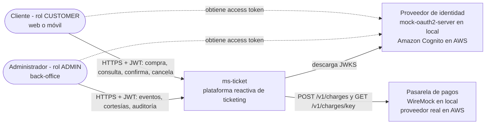

- Los clientes nunca envían su identidad en el body: el sistema usa el `sub` del JWT.
- La pasarela se llama solo desde el worker, con `Idempotency-Key = orderId`.

## 2. Contenedores (C4 nivel 2)

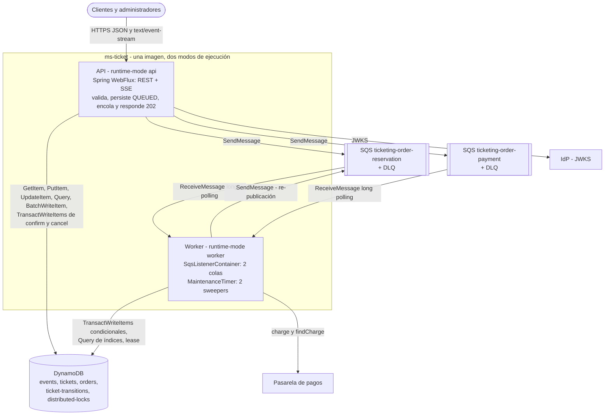

| Contenedor | Tecnología | Responsabilidad | Escala por |
|---|---|---|---|
| API | Spring Boot 4.1.1 WebFlux (Reactor Netty), Java 25 | Validar, autenticar, limitar, aceptar órdenes (`202`), confirmar/cancelar, consultas y SSE | CPU y peticiones por target (ALB) |
| Worker | misma imagen, `SqsListenerContainer` + `MaintenanceTimer` | Reservar, cobrar, liberar expiradas, conciliar pagos, re-publicar órdenes | *Backlog per task* de SQS |
| DynamoDB | on-demand, transacciones | Fuente de verdad: inventario, órdenes, auditoría, leases | automático |
| SQS Standard | 2 colas + 2 DLQ | *Load leveling* y desacople API/worker | automático |

## 3. Componentes por capa y regla de dependencias

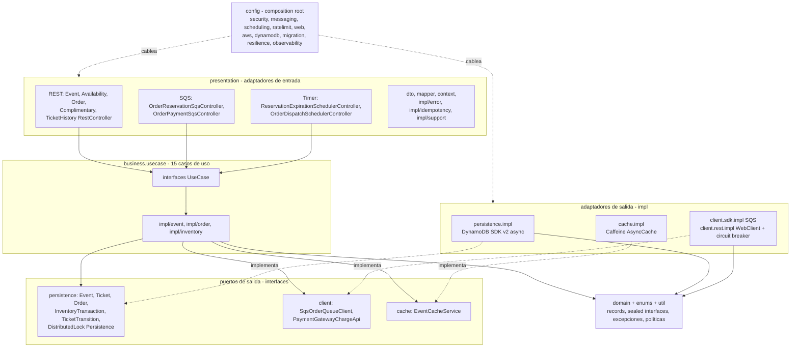

Regla (verificada por ArchUnit, ADR-0013):

```
presentation → business.usecase (interfaces) → persistence | client | cache (interfaces) → domain
config = composition root (puede depender de todo; nada depende de config)
```

| Paquete | Puede usar | No puede usar |
|---|---|---|
| `domain`, `enums` | `java..` (y entre sí) | Spring, Reactor, AWS, Jackson, cualquier otra capa |
| `util` | `java..`, `reactor..` | cualquier otra capa |
| `business` | `domain`, `enums`, `util`, **interfaces raíz** de `persistence`, `client.sdk`, `client.rest.api`, `cache`, Reactor, estereotipos Spring, SLF4J | `presentation`, `config`, `impl`, `entity`, DTOs |
| `presentation` | interfaces de `business.usecase`, `domain`, `enums`, `util`, Spring Web/Security, Jackson, Validation | `business..impl`, `persistence`, `client`, `cache`, `config` |
| `persistence` / `client` / `cache` | `domain`, `enums`, `util`, su SDK | las demás capas |

### Cadena de una petición HTTP

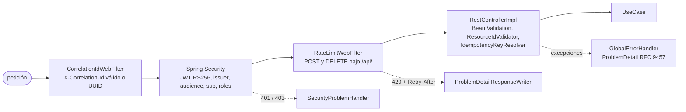

Los cuerpos se decodifican con un límite de **256 KB** (`WebFluxConfig`, `413` si se excede). El
`correlationId` viaja en el contexto Reactor y, por propagación automática, en el MDC de los logs;
se publica como atributo del mensaje SQS y el consumidor lo restaura.

## 4. Máquinas de estado

### 4.1 Entrada (`TicketStatusEnum`)

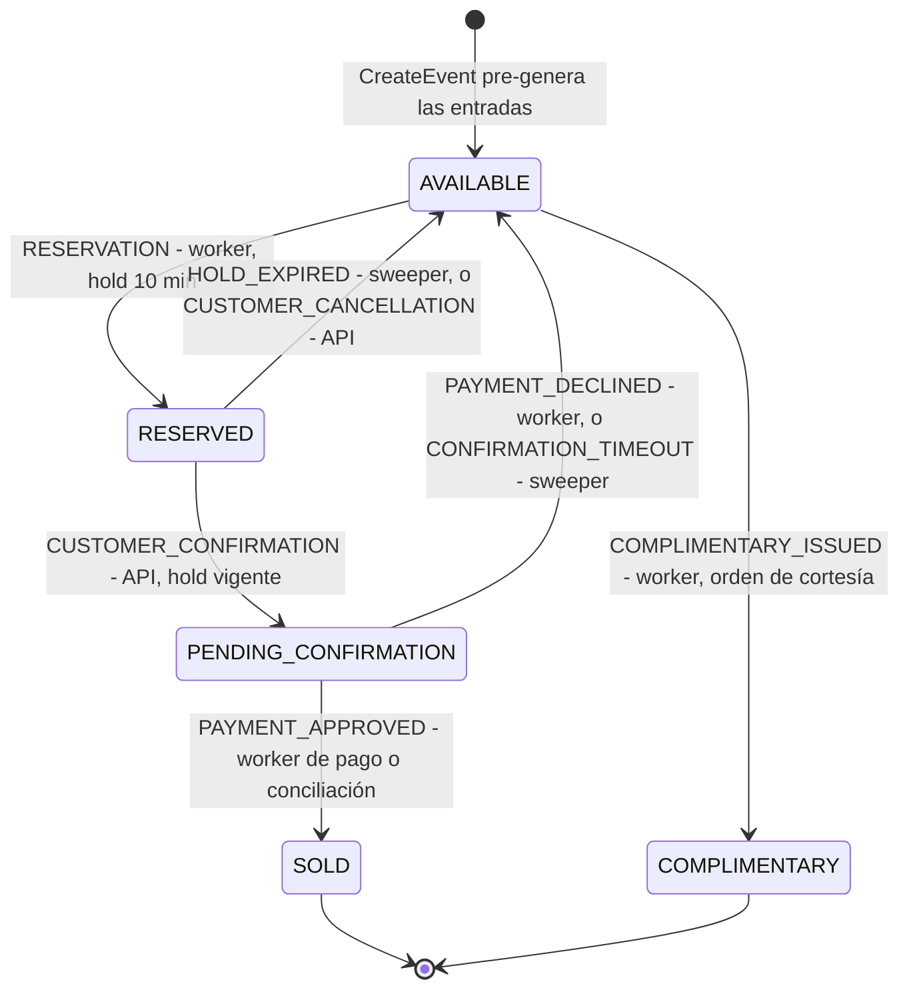

- Las transiciones válidas están codificadas en `TicketStatusEnum.canTransitionTo` (switch
  exhaustivo) y `TicketStateMachine` (`sourceOf`/`targetOf` por `TransitionReasonEnum`); cualquier
  otra, incluida `X → X`, es inválida.
- `SOLD` y `COMPLIMENTARY` son finales. `COMPLIMENTARY` **no es contable** (`isAccountable()` solo
  es `true` para `SOLD`) y tiene su propio contador `complimentaryCount`.
- Cada transición es **atómica** (misma transacción que contadores y orden) y **auditable** (un
  registro en `ticket-transitions` con `from`, `to`, `orderId`, `reason`, `actor`, `occurredAt`),
  consultable en `GET /api/v1/events/{eventId}/tickets/{ticketId}/transitions` (ADMIN).

### 4.2 Orden (`processingStatus` × `status` de sus entradas)

La respuesta de una orden expone **dos campos**: `status` (el estado de sus entradas,
`TicketStatusEnum`, lo que pide el enunciado) y `processingStatus` (`OrderProcessingStatusEnum`, el
ciclo de vida de la orden), más `reason` cuando aplica.

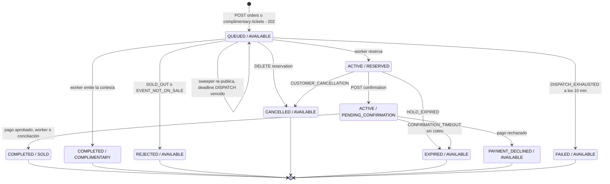

| `processingStatus` | Significado | `reason` |
|---|---|---|
| `QUEUED` | aceptada, esperando al worker | — |
| `ACTIVE` | con entradas retenidas (`RESERVED` o `PENDING_CONFIRMATION`) | — |
| `COMPLETED` | vendida (`SOLD`) o cortesía emitida (`COMPLIMENTARY`) | — |
| `REJECTED` | sin stock o evento no a la venta | `SOLD_OUT`, `EVENT_NOT_ON_SALE` |
| `CANCELLED` | cancelada por el cliente | `CUSTOMER_CANCELLATION` |
| `EXPIRED` | venció el hold o la confirmación sin cobro | `HOLD_EXPIRED`, `CONFIRMATION_TIMEOUT` |
| `PAYMENT_DECLINED` | la pasarela rechazó el cobro | `PAYMENT_DECLINED` |
| `FAILED` | no se pudo despachar en 10 min | `DISPATCH_EXHAUSTED` |

Los estados terminales eliminan el deadline de la orden (sale del índice de deadlines).

## 5. Flujos (diagramas de secuencia)

### 5.1 Compra completa

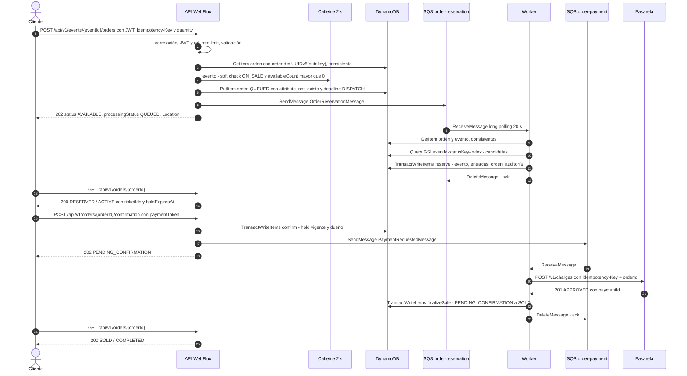

La API nunca toca el inventario al aceptar: solo persiste la orden y encola (*load leveling*). La
confirmación sí es una transacción en la API porque es corta, individual y el cliente necesita la
respuesta (`410 HOLD_EXPIRED` si llegó tarde).

### 5.2 Reserva concurrente con conflicto y reintento

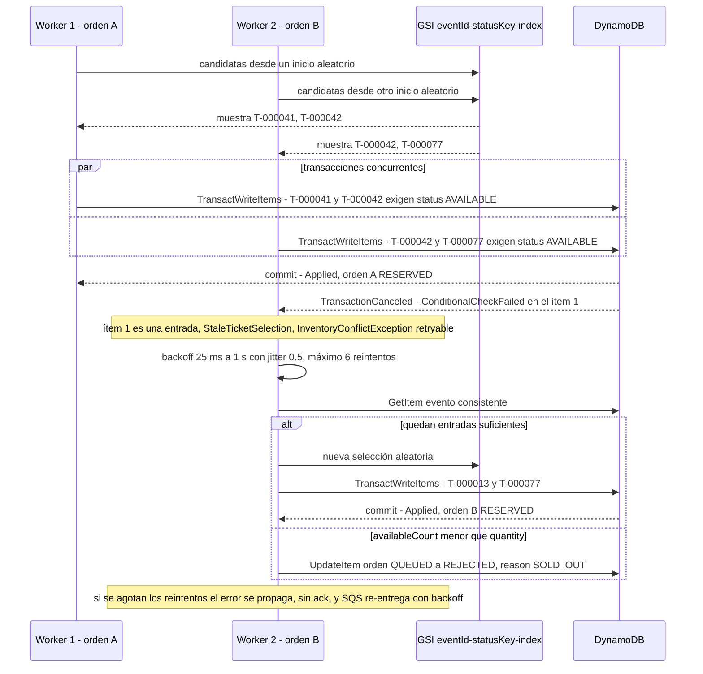

Ningún resultado deja una entrada en dos órdenes: la condición `#status = :from` de cada entrada y
`availableCount >= :q` del evento se evalúan atómicamente en la misma transacción. Si dos entregas
del **mismo** mensaje compiten, la condición `processingStatus = QUEUED` de la orden hace que la
segunda obtenga `OrderStateChanged` y devuelva el estado ya reservado.

### 5.3 Confirmación vs expiración (carrera)

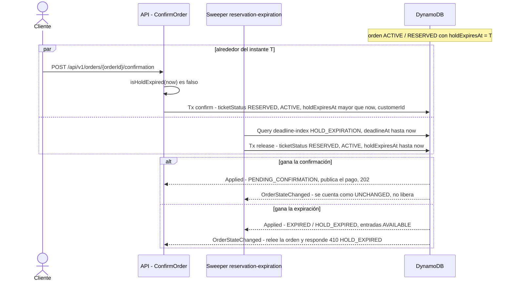

Ambas transacciones condicionan el **mismo ítem de orden** (`ticketStatus = RESERVED AND
processingStatus = ACTIVE`), así que DynamoDB las serializa: exactamente una gana, aunque los relojes
de las instancias difieran. `ConfirmOrder` responde `410 HOLD_EXPIRED` también cuando la orden ya
fue barrida (`EXPIRED` con `reason = HOLD_EXPIRED`), para que la respuesta no dependa de si el
sweeper ya pasó.

### 5.4 Pago rechazado (y pasarela caída)

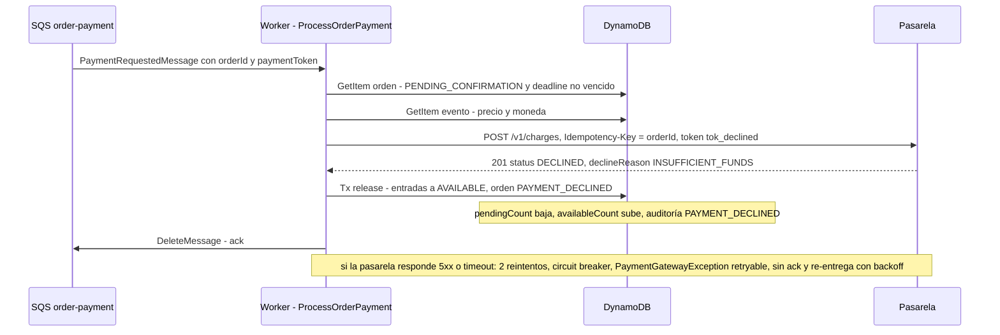

- `ProcessOrderPayment` **no inicia un cobro** si el deadline de confirmación ya venció: desde ese
  instante la orden pertenece a la conciliación del sweeper (5.5).
- Si el cobro fue aprobado pero la orden ya no estaba pendiente (carrera extrema con la
  conciliación), se registra el ERROR `Payment captured for released order ... manual refund
  required` (limitación documentada).
- La escritura posterior al cobro se reintenta localmente (`inventoryRetryPolicy`) porque el dinero
  ya fue capturado.

### 5.5 Sweeper con lease distribuido y conciliación de pagos

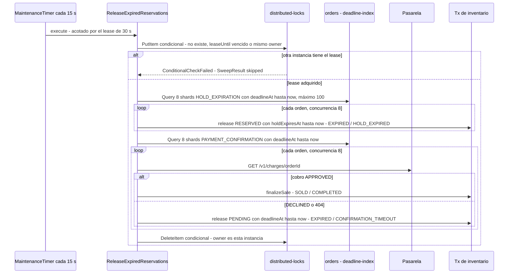

- El lease (`tryAcquire`: `attribute_not_exists(lockName) OR leaseUntil < :now OR #owner = :owner`)
  evita trabajo duplicado entre réplicas; la **corrección** no depende de él porque cada liberación
  es condicional. Se libera siempre (`Mono.usingWhen`, también ante error o cancelación); si la
  liberación falla, el lease expira solo (y el TTL `expiresAt` limpia el ítem).
- Un error en una orden se cuenta como `failed` y la orden sigue vencida para el siguiente ciclo:
  una orden problemática nunca aborta el barrido.
- Los pagos pendientes **nunca se liberan a ciegas**: primero se consulta la pasarela.

### 5.6 Re-publicación de órdenes `QUEUED` (outbox "lite")

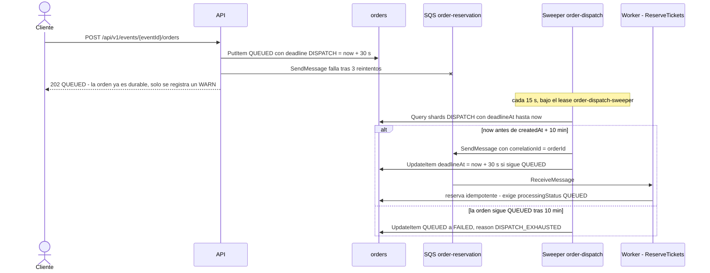

### 5.7 SSE de disponibilidad

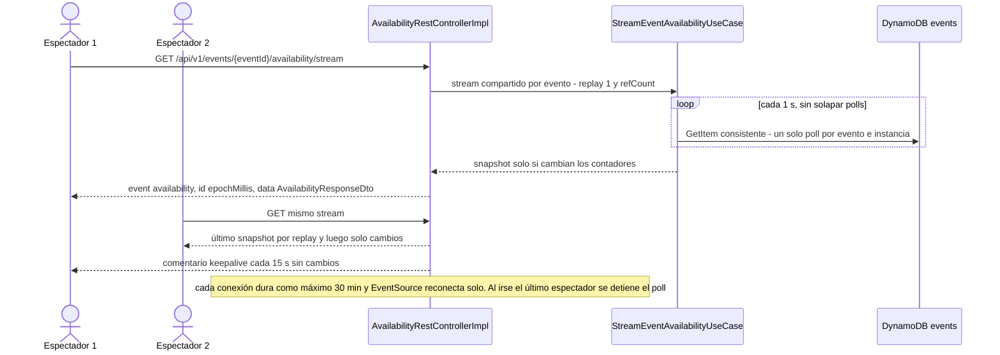

Ejemplo real de un frame:

```
id:1791692524615
event:availability
data:{"eventId":"51871790-1a19-41da-83a9-57fd8476846d","totalCapacity":100,"available":95,"reserved":1,"pendingConfirmation":0,"sold":2,"complimentary":2,"capturedAt":"2026-10-11T04:22:04.615010446Z"}
```

El costo no crece con la audiencia: una lectura consistente por segundo **por evento e instancia**,
sin importar cuántas conexiones haya. En producción el reemplazo natural es *push* desde DynamoDB
Streams (ver [limitaciones](limitations-and-improvements.md)).

## 6. Modelo de datos DynamoDB

Tablas *single-purpose*, **on-demand** (`PAY_PER_REQUEST`). Instantes como **Number epoch ms**
(las condiciones de rango comparan números); dinero como String (`BigDecimal.toPlainString()`).
Nombres locales: `ticketing-<tabla>`; en AWS `<project>-<env>-<tabla>`.

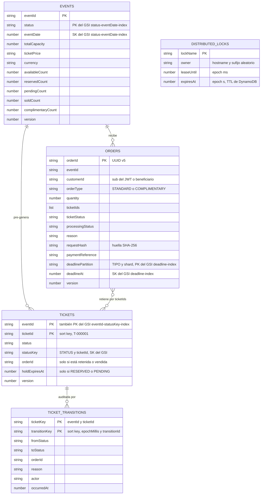

| Tabla | Clave | Índices | Notas |
|---|---|---|---|
| `events` | PK `eventId` | GSI `status-eventDate-index` (PK `status`, SK `eventDate`, `ALL`) | Contadores de inventario; solo cambian dentro de las transacciones. Listado paginado con cursor opaco Base64 |
| `tickets` | PK `eventId`, SK `ticketId` | GSI `eventId-statusKey-index` (PK `eventId`, SK `statusKey`, `INCLUDE status, version, updatedAt`) | `statusKey = <STATUS>#<ticketId>` se reescribe en cada transición: "entradas libres" es un rango de clave |
| `orders` | PK `orderId` | GSI `deadline-index` (PK `deadlinePartition`, SK `deadlineAt`, `ALL`) **disperso** | `deadlinePartition = <DeadlineTypeEnum>#<shard>`, 8 shards (ADR-0011) |
| `ticket-transitions` | PK `ticketKey = <eventId>#<ticketId>`, SK `transitionKey = <epochMillis 13 dígitos>#<transitionId>` | — | Solo inserciones (`attribute_not_exists`); `transitionId` determinístico (UUIDv5 del token de la transacción + ticketId) |
| `distributed-locks` | PK `lockName` | — | TTL sobre `expiresAt` |
| `schema-migrations` | PK `migrationId` | — | Solo local/CI (`DynamoMigrationRunner`); en AWS el esquema es de Terraform |

Las tablas locales las crea `DynamoMigrationRunner` (perfil `local`/`ci`) a partir de
`src/main/resources/db/changelog/db.changelog-master.yaml` y `db/migrations/<yyyyMMddHHmmss>_<TICKET>/`
(un JSON con el subconjunto de `CreateTable`), con checksum SHA-256 y fallo rápido si una migración
aplicada cambió. Terraform (`infra/terraform/modules/dynamodb`) replica las mismas definiciones.

## 7. Transacciones y escrituras condicionales por operación

Cada operación de inventario es **un** `TransactWriteItems` con el orden fijo
`[0] evento, [1..n] entradas, [n+1] orden, [n+2..2n+1] auditoría`. Todos los `Update` agregan
`SET updatedAt = :now ADD version :one`; toda auditoría es un `Put` con
`attribute_not_exists(ticketKey)`.

| Operación | Quién | Evento `[0]` | Entradas `[1..n]` | Orden `[n+1]` |
|---|---|---|---|---|
| `reserve` | worker | `availableCount -= q, reservedCount += q` si `#status = ON_SALE AND availableCount >= :q` | `AVAILABLE → RESERVED`, `statusKey`, `orderId`, `holdExpiresAt` si `#status = AVAILABLE` | `RESERVED`/`ACTIVE`, `ticketIds`, `holdExpiresAt`, deadline `HOLD_EXPIRATION` si `processingStatus = QUEUED` |
| `issueComplimentary` | worker | `availableCount -= q, complimentaryCount += q` si `#status = ON_SALE AND availableCount >= :q` | `AVAILABLE → COMPLIMENTARY`, `statusKey`, `orderId` si `#status = AVAILABLE` | `COMPLIMENTARY`/`COMPLETED`, `ticketIds`, `REMOVE` deadline si `processingStatus = QUEUED` |
| `confirm` | API (cliente) | `reservedCount -= q, pendingCount += q` si `attribute_exists(eventId)` | `RESERVED → PENDING_CONFIRMATION`, `statusKey` si `#status = RESERVED AND orderId = :orderId` | `PENDING_CONFIRMATION`, deadline `PAYMENT_CONFIRMATION` (now + 5 min) si `ticketStatus = RESERVED AND processingStatus = ACTIVE AND holdExpiresAt > :now AND customerId = :customerId` |
| `finalizeSale` | worker de pago o sweeper | `pendingCount -= q, soldCount += q` si `attribute_exists(eventId)` | `PENDING_CONFIRMATION → SOLD`, `statusKey`, `REMOVE holdExpiresAt` si `#status = PENDING_CONFIRMATION AND orderId = :orderId` | `SOLD`/`COMPLETED`, `paymentReference`, `REMOVE` deadline si `ticketStatus = PENDING_CONFIRMATION AND processingStatus = ACTIVE` |
| `release` | API (cancelar), worker (pago rechazado), sweeper (expiración, timeout) | `availableCount += q` y `reservedCount -= q` o `pendingCount -= q` si `attribute_exists(eventId)` | `esperado → AVAILABLE`, `statusKey = AVAILABLE#id`, `REMOVE orderId, holdExpiresAt` si `#status = :expected AND orderId = :orderId` | `AVAILABLE`/estado terminal, `reason`, `REMOVE` deadline si `ticketStatus = :expected AND processingStatus = ACTIVE` (+ `holdExpiresAt <= :now` si `HOLD_EXPIRED`; + `deadlineAt <= :now` si `CONFIRMATION_TIMEOUT`) |

`ClientRequestToken` = primeros 36 caracteres hex de
`sha256(operación | orderId | ticketIds ordenados | nowEpochMillis)` (las liberaciones usan
`release-<REASON>` como operación): estable para los reintentos del SDK de **un** comando y distinto
para un reintento de negocio (que es un comando nuevo), evitando
`IdempotentParameterMismatchException`.

Escrituras condicionales fuera de transacciones:

| Operación | Condición |
|---|---|
| `EventPersistence.create` | `attribute_not_exists(eventId)` |
| `EventPersistence.updateStatus` (`PUBLISHING → ON_SALE`) | `#status = :expected` |
| `OrderPersistence.insertIfAbsent` | `attribute_not_exists(orderId)` |
| `OrderPersistence.transitionProcessingStatus` (rechazo, cancelación en cola, `FAILED`) | `processingStatus = :expected` (elimina el deadline si el destino es terminal) |
| `OrderPersistence.rescheduleDeadline` | `processingStatus = :expected` |
| `DistributedLockPersistence.tryAcquire` | `attribute_not_exists(lockName) OR leaseUntil < :now OR #owner = :owner` |
| `DistributedLockPersistence.release` | `#owner = :owner` |

## 8. Manejo de errores y reintentos

### 8.1 Errores de la API

Todas las respuestas de error son `application/problem+json` (RFC 9457) con `title` = código,
`detail` seguro para el cliente, `instance` (ruta) y las extensiones `errorCode`, `correlationId` y
`timestamp` (y `errors: [{field, message}]` en validaciones). Nunca se exponen trazas.

| `errorCode` | HTTP | Reintentable | Cuándo |
|---|---|---|---|
| `VALIDATION_ERROR` | 400 | no | Bean Validation, parámetros inválidos, ids de ruta fuera de `^[A-Za-z0-9-]{1,64}$`, cursor inválido |
| `INVALID_IDEMPOTENCY_KEY` | 400 | no | `Idempotency-Key` ausente o fuera de `^[A-Za-z0-9-]{8,64}$` |
| `UNAUTHORIZED` | 401 | no | sin token o token inválido (`WWW-Authenticate: Bearer ...`) |
| `FORBIDDEN` | 403 | no | rol insuficiente |
| `EVENT_NOT_FOUND` / `ORDER_NOT_FOUND` | 404 | no | inexistente, u orden de otro cliente (anti-IDOR) |
| `EVENT_NOT_ON_SALE` | 409 | no | evento no `ON_SALE` |
| `SOLD_OUT` | 409 | no | *soft check*: `availableCount == 0` según la caché |
| `INVALID_ORDER_STATE` | 409 | no | confirmar/cancelar en un estado que no lo permite |
| `HOLD_EXPIRED` | 410 | no | confirmación después del vencimiento del hold |
| `IDEMPOTENCY_KEY_REUSED` | 422 | no | misma clave con otro payload |
| `RATE_LIMIT_EXCEEDED` | 429 | no | cubeta agotada (`Retry-After`) |
| `INTERNAL_ERROR` | 500 | no | inesperado (se registra, no se expone) |
| `INVENTORY_CONFLICT`, `MESSAGE_PUBLISHING_FAILED`, `PAYMENT_GATEWAY_UNAVAILABLE` | 503 | sí | transitorio (`Retry-After: 1`) |

Errores del framework (`404` ruta inexistente, `405`, `406`, `413`, `415`) también son
`ProblemDetail`, sin `errorCode` cuando no hay un código de negocio equivalente.

### 8.2 Reintentos por nivel

| Nivel | Qué se reintenta | Política |
|---|---|---|
| AWS SDK (DynamoDB, SQS) | throttling, 5xx, I/O | `RetryMode.STANDARD`; timeouts DynamoDB 3 s por intento / 10 s por llamada; SQS 25 s / 60 s; publicaciones 2 s / 5 s |
| Inventario (`ReserveTickets`, escritura posterior al cobro) | `InventoryConflictException`: `TransactionConflict`, throttling, 5xx, entrada ya tomada, índice atrasado | `ReactiveRetryUtil.backoff`: 6 reintentos, 25 ms..1 s, jitter 0.5; al agotarse se propaga el último error original |
| Publicación SQS desde la API | `MessagePublishingException` | 3 reintentos, 100 ms..1 s; luego WARN y el sweeper re-publica (ADR-0006) |
| Pasarela de pagos | 5xx, timeouts, I/O (**no** 4xx ni 429) | timeout 4 s por intento, 2 reintentos (100 ms, tope 1 s, jitter 0.5), circuit breaker `paymentGateway` (abre con ≥ 50 % de fallos en 20 llamadas, 30 s abierto, 5 llamadas en half-open) |
| Mensaje SQS | error retryable, mensaje malformado, timeout del handler | sin ack: visibilidad `min(2^receiveCount × 5 s, 300 s)` → 10 s, 20 s, 40 s, 80 s, 160 s; DLQ tras 5 recepciones |
| Cancelación (`CancelOrder`) | carrera perdida (`OrderStateChanged`) | re-evalúa sobre la orden recargada hasta 2 veces; luego `503 INVENTORY_CONFLICT` |
| Sweepers | error en una orden | se cuenta `failed`; la orden sigue vencida y entra en el siguiente ciclo |

### 8.3 Procesamiento de un mensaje SQS

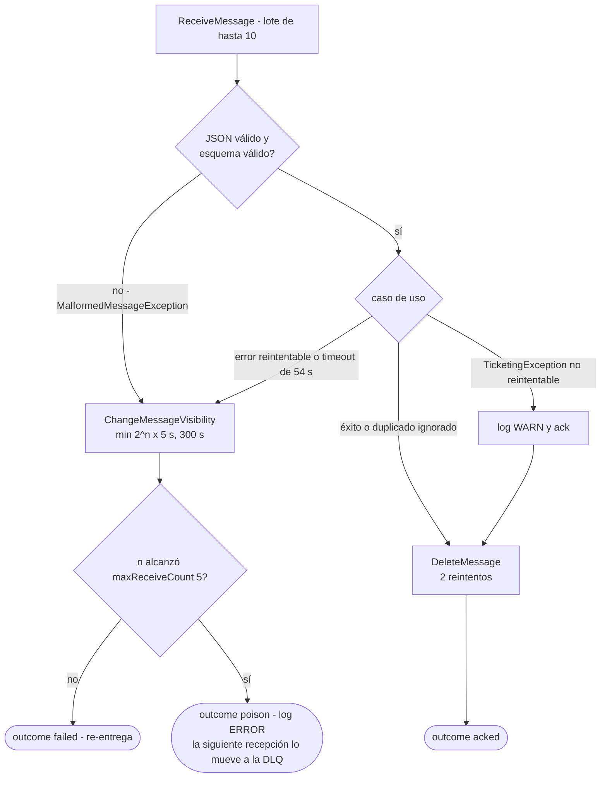

Si el borrado falla tras sus reintentos el resultado también es `failed`: el mensaje se re-entrega y
el consumidor idempotente lo descarta.

## 9. Modos de ejecución `api` / `worker`

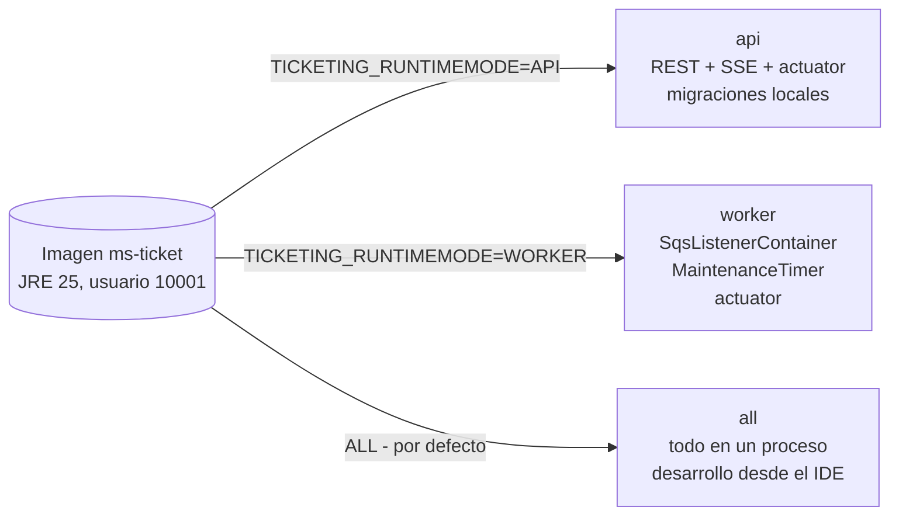

- `WorkerModeCondition` activa `SqsListenerConfig` y `SchedulingConfig` solo en `all`/`worker`.
- Ciclo de vida: el `SqsListenerContainer` comparte la fase del *graceful shutdown* del servidor web
  y drena dentro del 90 % de `spring.lifecycle.timeout-per-shutdown-phase` (30 s); el
  `MaintenanceTimer` (fase `DEFAULT_PHASE - 512`) se detiene antes, cancelando un barrido en curso
  (el lease se libera reactivamente y cada orden queda consistente porque cada transición es una
  escritura condicional).
- Compose: `stop_grace_period: 45s`. ECS: `stopTimeout` 60 s (Terraform).
- Detalle y justificación: [ADR-0008](adr/0008-runtime-modes.md).

## 10. Configuración relevante (valores por defecto)

| Propiedad | Valor | Uso |
|---|---|---|
| `ticketing.orders.hold-ttl` | `10m` | duración de la reserva |
| `ticketing.orders.confirmation-timeout` | `5m` | plazo para que el pago se resuelva antes de conciliar |
| `ticketing.orders.republish-after` | `30s` | deadline de despacho (outbox lite) |
| `ticketing.orders.max-tickets-per-order` / `max-complimentary-per-request` | `10` / `40` | límites por orden |
| `ticketing.orders.candidate-factor` | `3` | ventana de candidatas = cantidad × 3 |
| `ticketing.events.max-capacity` | `20000` | capacidad máxima por evento |
| `ticketing.events.availability-stream-interval` | `1s` | poll del SSE |
| `ticketing.events.ticket-write-concurrency` | `4` | tramos paralelos al pre-generar |
| `ticketing.cache.event-ttl` / `event-max-size` | `2s` / `10000` | caché de eventos (lecturas y *soft check*) |
| `ticketing.sweeper.interval` / `lease` / `batch-size` / `concurrency` | `15s` / `30s` / `100` / `8` | sweepers |
| `ticketing.retry.inventory.*` | 6, `25ms`..`1s`, jitter `0.5` | reintentos de inventario |
| `ticketing.retry.publish.*` | 3, `100ms`..`1s`, jitter `0.5` | reintentos de publicación |
| `ticketing.rate-limit.*` | `enabled`, capacidad `20`, `20` tokens cada `1s` | rate limit por sujeto |
| `ticketing.messaging.*` | `max-messages 10`, `wait-time-seconds 20`, `visibility-timeout-seconds 60`, `concurrency 16`, `pollers 2` | listener SQS |
| `ticketing.payment.*` | connect `1s`, response `3s`, call `4s`, `max-retries 2`, backoff `100ms` | cliente de pagos |
| `ticketing.security.*` | `audience ms-ticket`, `issuer`, `roles-claim roles` | validación JWT |
| `aws.dynamodb.deadline-shards` | `8` | shards del índice de deadlines |
| `spring.lifecycle.timeout-per-shutdown-phase` | `30s` | presupuesto de apagado |

Perfiles: `local` (DynamoDB Local, LocalStack, WireMock, mock-oauth2; migraciones activas; logs de
texto), `ci` (Testcontainers; logs ECS JSON), `dev` y `prod` (AWS; sin migraciones; logs ECS JSON;
`prod` exige por variables de entorno cada valor sin default).
