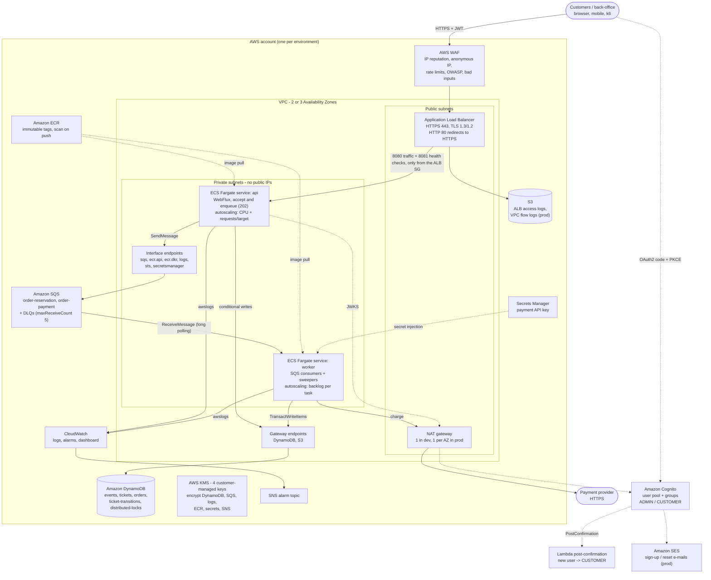

# ms-ticket - AWS infrastructure (Terraform)

Production-grade, cloud-native infrastructure for the reactive ticketing platform:
**ECS Fargate** (one image, two services: `api` and `worker`), **DynamoDB** (conditional
transactions), **SQS** (load leveling + DLQs), **ALB + WAF** at the edge, **Cognito** as the
identity provider, customer-managed **KMS** keys everywhere, and **CloudWatch** alarms,
dashboard and budgets. Nothing here needs to be clicked in the console.

```
infra/terraform/
├── modules/
│   ├── network/        VPC 2-3 AZ, public/private subnets, NAT (1 or per AZ), VPC endpoints, flow logs (S3 Parquet or CloudWatch)
│   ├── kms/            CMKs (dynamodb, sqs, logs, platform) with rotation and service-scoped key policies
│   ├── dynamodb/       the 5 tables of implementation-spec §6.1, GSIs, PITR, SSE-KMS, TTL, contributor insights
│   ├── sqs/            order-reservation / order-payment + one DLQ each, KMS, TLS-only queue policies
│   ├── ecr/            immutable tags, scan on push, KMS, lifecycle policy
│   ├── alb_waf/        internet-facing ALB (TLS 1.3/1.2), HTTP->HTTPS, access logs bucket, WAFv2 + logging
│   ├── ecs_cluster/    Fargate / Fargate Spot cluster, Container Insights, audited ECS Exec
│   ├── ecs_service/    reusable hardened Fargate service (instantiated as "api" and "worker")
│   ├── auth/           Cognito user pool, ADMIN/CUSTOMER groups, post-confirmation Lambda, SES e-mail, resource server, PKCE web client
│   └── observability/  log groups, SNS alarm topic, alarms, dashboard, AWS Budget
├── envs/
│   ├── dev/            backend.tf, providers.tf, main.tf, iam.tf, variables.tf, terraform.tfvars, outputs.tf, tests/
│   └── prod/           same files; only terraform.tfvars and the backend key differ
├── scripts/validate.sh fmt + validate + offline tests + tflint + checkov (Docker, no AWS credentials)
└── .tflint.hcl
```

---

## 1. Architecture



Request path: the API only validates, writes the order (`QUEUED`, idempotent `orderId`) and
publishes to SQS. The worker does the contended work (DynamoDB transactions with conditions) at a
bounded concurrency. Spikes become queue depth, and queue depth drives worker autoscaling, instead
of timeouts.

### 1.1 Networking

| Decision | Why |
|---|---|
| Public subnets only hold the ALB and NAT gateways (`map_public_ip_on_launch = false`) | Tasks are never directly reachable from the internet |
| Private subnets of a `/18` each (for a `/16`) | Fargate uses one ENI/IP per task, so autoscaling never runs out of IPs |
| **DynamoDB + S3 gateway endpoints** (free) | All table traffic and ECR image layers bypass the NAT: no data-processing charge, no internet path |
| Interface endpoints (private DNS) for SQS, ECR, Logs, STS, Secrets Manager | AWS API traffic stays on the AWS network; works even if NAT is down |
| Endpoint policies: DynamoDB only for **this account's** tables and principals; S3 only for this account's buckets plus the ECR layer bucket | Data perimeter: stolen credentials cannot exfiltrate to a foreign table or bucket through the VPC |
| NAT: `single_nat_gateway = true` in dev, one per AZ in prod | dev saves one NAT per extra AZ (~$33/month each); prod has no cross-AZ egress dependency |
| `availability_zones` pinned, validated with a `zone-name` filter | The network never changes on its own when AWS adds an AZ |
| Default security group stripped of all rules | Nothing can accidentally use it |
| VPC flow logs: **prod** ALL traffic to **S3** (Parquet, Hive-compatible hourly partitions, SSE-KMS, Intelligent-Tiering after 30 days, expiry at retention); **dev** REJECT-only to a KMS-encrypted log group | Network forensics (Athena in prod) at S3 prices instead of CloudWatch Logs ingestion (~$0.50/GB) |

---

## 2. Security

### 2.1 Identity and access (least privilege)

* **No long-lived credentials anywhere.** Tasks use IAM **task roles**; the AWS SDK picks them
  up through `DefaultCredentialsProvider`. CI should assume a deploy role through GitHub OIDC.
* **One execution role and one task role per service** (no shared roles, no AWS-managed wildcard
  policies). Trust policies carry `aws:SourceAccount` / `aws:SourceArn` (confused-deputy protection).
* Application permissions (`envs/*/iam.tf`) are derived from the data access in the
  implementation spec and scoped to **table and index ARNs**:

| | api | worker |
|---|---|---|
| events | Get/Put/Update, Query `status-eventDate-index` | Get/Update |
| tickets | Get/BatchWrite (ticket pre-generation)/Update | Get/BatchGet (`findByIds`)/Update, Query `eventId-statusKey-index` (`findAvailable`) |
| orders | Get/Put/Update | Get/Update, Query `deadline-index` |
| ticket-transitions | **PutItem (insert) + Query** | **PutItem (insert)** |
| distributed-locks | - | Get/Put/Update/Delete (sweeper lease) |
| SQS | `SendMessage` to both queues | Receive/Delete/ChangeMessageVisibility/GetQueueAttributes on both, `SendMessage` to order-reservation (republish) |
| KMS | SQS and DynamoDB keys, **only through** `kms:ViaService` | same |
| Secrets Manager | - | payment API key (via execution role) |

  `TransactWriteItems` is not an IAM action: DynamoDB authorizes each item of a transaction with
  its own action. The transactions of implementation-spec §6.3 only hold `Update` and `Put` items,
  so **`dynamodb:ConditionCheckItem` is granted to nobody**, and the API has no `BatchGetItem` (no
  API use case reads tickets in batch).
* **Audit trail (`ticket-transitions`) - what IAM can and cannot guarantee.** No principal can
  `UpdateItem` or `DeleteItem` a record. `PutItem`, however, **can overwrite** an existing item, and
  IAM has no condition key that forces the `attribute_not_exists(ticketKey)` condition the
  application always sends: the trail is insert-only **by code**, not tamper-proof against a
  compromised task role. For tamper evidence: PITR (on) plus a scheduled
  `ExportTableToPointInTime` into an S3 bucket with **Object Lock (compliance mode)**, ideally in the
  log-archive account (section 8).
* **`BatchWriteItem`** (API, ticket pre-generation) authorizes `PutRequest` and `DeleteRequest`
  alike; IAM cannot restrict the request type. Accepted: scoped to the tickets table, and the code
  only sends `PutRequest`s.
* `allowed_account_ids` in the provider stops a `terraform apply` with the wrong credentials, for
  example dev code against the prod account.

### 2.2 Encryption

| Key (`alias/<project>-<env>-*`) | Protects | Who can use it |
|---|---|---|
| `dynamodb` | tables, PITR backups | IAM principals of the account **only via** `dynamodb.<region>.amazonaws.com` |
| `sqs` | queues and DLQs | only via `sqs.<region>.amazonaws.com` |
| `logs` | every log group (app, WAF, ECS Exec, Lambda, dev flow logs) and the prod flow-logs bucket | `logs.<region>.amazonaws.com` (encryption context: this account's log groups); `delivery.logs.amazonaws.com` for this account only (S3 flow logs); IAM principals only via `s3` (Athena reads) |
| `platform` | ECR images, Secrets Manager, SNS alarm topic | via `ecr` / `secretsmanager` / `sns`; `cloudwatch.amazonaws.com` to publish alarms |

All keys rotate automatically. Key administration (no crypto use) defaults to the account root,
which delegates to IAM; set `key_administrator_arns` to restrict it to named roles. Grants are
only allowed when `kms:GrantIsForAWSResource = true`. In transit: TLS 1.3/1.2 at the ALB (HSTS
added by the listener), **queue, topic and bucket policies deny `aws:SecureTransport = false`**,
and the SDK always uses HTTPS (VPC endpoints).

**Accepted risk - ALB to task traffic is plain HTTP.** TLS terminates at the ALB; the hop to the
tasks (8080, and 8081 for health checks) stays inside private subnets of a VPC that is not
reachable from the internet, and the task security group only accepts the ALB security group.
Sniffing that hop requires a foothold inside the VPC. If a compliance regime requires
end-to-end encryption: switch the target group to `HTTPS` (the ALB does not validate target
certificates, so a certificate generated at container start, or one issued by AWS Private CA, is
enough), enable TLS on the Spring Boot server, and keep the health check on HTTPS as well.

### 2.3 Edge protection (WAF + ALB)

| # | Rule | Action |
|---|---|---|
| 0 | `AWSManagedRulesAmazonIpReputationList` | block known malicious IPs and botnets |
| 1 | `AWSManagedRulesAnonymousIpList` | block hosting-provider IPs (where scalper bots run); VPN/Tor only **counted** (configurable) |
| 2 | **`/actuator` prefix** on the URI path after `URL_DECODE` + `NORMALIZE_PATH` + `LOWERCASE` (defeats `/%61ctuator`, `//actuator`, `/api/../actuator`, `/ACTUATOR`) | 404 |
| 3 | Rate limit per IP (`waf_rate_limit_per_ip` / 5 min) | 429 in RFC 9457 shape |
| 4 | **Stricter rate limit on `POST /api/v1/events/*/orders`** (URL-decoded and path-normalized before matching) | 429, anti-bot / anti-scalping for ticket drops |
| 5 | `AWSManagedRulesCommonRuleSet` (OWASP top 10) | block |
| 6 | `AWSManagedRulesKnownBadInputsRuleSet` (Log4Shell and similar) | block |

WAF logs go to CloudWatch with `Authorization` and `Cookie` **redacted**, keeping only BLOCK/COUNT
events (cost). The in-app per-customer limiter (Bucket4j) still applies behind the WAF.
The ALB drops invalid headers, uses `defensive` desync mitigation, hides the `Server` header and
adds HSTS/nosniff/frame-deny.

**Actuator is never public - three layers:**
1. **Separate management port.** Terraform injects `MANAGEMENT_SERVER_PORT=8081`
   (`management.server.port`): actuator is not served on 8080 at all. The listener forwards client
   traffic to the target group port 8080 only; the **target group health check** calls
   `/actuator/health/readiness` on **8081**; the task security group accepts 8081 only from the ALB
   security group (and the ALB security group may only reach 8080/8081 inside the VPC). An in-VPC
   Prometheus scraper (ADOT / Amazon Managed Prometheus) needs its own ingress rule on 8081.
2. **WAF rule 2** blocks the usual encoded and non-normalised variants of `/actuator` (single
   percent-encoding, duplicate slashes, dot segments, upper case).
3. **Listener rule** answers 404 for the plain `/actuator` and `/actuator/*` paths.

**Client IP behind the ALB.** The ALB *appends* the address of its peer to `X-Forwarded-For`;
everything to the left of that hop is supplied by the client and can be forged. The application
therefore takes the **rightmost** `X-Forwarded-For` hop (the one the ALB added) as the client IP
(per-IP fallback of the in-app limiter, logs). WAF rate-based rules aggregate on the source IP of
the connection to the ALB, not on headers, so they cannot be dodged with a forged header either.

### 2.4 Workload hardening (ECS)

* Private subnets, `assign_public_ip = false`; the **api SG accepts traffic only from the ALB SG**;
  the **worker has no ingress rule at all**; egress is 443 only.
* Container: **non-root** (`user = 10001:10001`), **read-only root filesystem** with an ephemeral
  task volume on `/tmp` (Fargate has no tmpfs). The image declares `VOLUME /tmp` with mode `1777`,
  so uid 10001 can write there (Netty native libraries, multipart temp files). **All Linux
  capabilities dropped**, init process, no privileged mode, `awslogs` in non-blocking mode (a log
  back-pressure never blocks the event loop).
* **ECS Exec** (dev only) needs a writable `/var/lib/amazon` and `/var/log/amazon` for the SSM
  agent; those two task volumes are mounted **only when `enable_execute_command = true`**.
* **Container health check (worker):** `/usr/local/bin/healthcheck` from the image (bash
  `/dev/tcp`, no curl/wget in the JRE image, no second JVM) against
  `/actuator/health/readiness` on the management port (`HEALTHCHECK_PORT=8081`); 15 s interval,
  90 s start period. ECS replaces an unhealthy worker, and a release whose workers never get
  ready trips the deployment circuit breaker.
* Secrets are injected by ECS from Secrets Manager (`valueFrom`) and never stored in the task
  definition or the state. The Terraform-managed version is a placeholder ignored afterwards; the real
  value is set out-of-band.
* ECR: **immutable tags** (a tag means one build, e.g. the git SHA), **scan on push**, KMS. The
  `image` variable rejects `:latest`.
* **ECS Exec is disabled in prod** (enforced by a cross-variable validation); in dev, sessions
  are recorded in a KMS-encrypted log group.

### 2.5 Identity provider (Cognito)

* Strong password policy (12+ characters, all character classes, history of 5), TOTP MFA
  (`OPTIONAL` or `ON`), e-mail as username, no user-existence leaks, token revocation,
  15-minute access tokens.
* **Threat protection** (advanced security `ENFORCED`, Plus tier) in prod: compromised-credential
  checks and adaptive MFA on risky sign-ins. dev uses the Essentials tier (cheaper).
* Groups **`ADMIN`** and **`CUSTOMER`**, resource server **`ms-ticket`** with scopes
  `orders.read`, `orders.write`, `events.admin`, and a public **authorization code + PKCE** client
  (no client secret in a browser).
* **Self-sign-up lands in `CUSTOMER`** through a **Post Confirmation Lambda trigger** (without a
  group, the token has no `cognito:groups` claim and every order endpoint answers 403). Python 3.13
  on arm64, packaged inline by `archive_file` from `modules/auth/lambda/post_confirmation.py`;
  handles `PostConfirmation_ConfirmSignUp` only. Least privilege: `cognito-idp:AdminAddUserToGroup`
  on **this user pool's ARN** only; logs only to its own **KMS-encrypted** log group (JSON format);
  X-Ray traces only with `auth_trigger_xray_tracing = true`. The invoke permission is limited to
  `cognito-idp.amazonaws.com` with `source_arn` = the pool and `source_account`. A failed or
  throttled invocation raises the `*-cognito-post-confirmation-lambda-errors` alarm; affected users
  are confirmed but group-less until an operator runs
  `aws cognito-idp admin-add-user-to-group --user-pool-id <id> --username <sub> --group-name CUSTOMER`.
  Users created by administrators (`AdminCreateUser`) do not fire the trigger: assign their group
  explicitly (`ADMIN` is never assigned automatically).
* **E-mail (sign-up codes, password resets).** The Cognito default sender is capped at a few
  dozen e-mails per day per account: acceptable in dev, an outage in prod. With
  `auth_ses_identity_arn` (+ `auth_email_from_address`) the pool uses
  `email_sending_account = DEVELOPER` and sends through **SES** (Cognito uses its service-linked
  role `AWSServiceRoleForAmazonCognitoIdpEmailService`). A variable validation makes both
  **mandatory when `environment = prod`**. Prerequisites: the identity (domain recommended, with
  DKIM/SPF/DMARC) is verified in the region and the account has SES **production access** (out of
  the sandbox).
* **How the API gets the `roles` claim.** Cognito puts group membership into the
  **`cognito:groups`** claim, so the simplest mapping, used here, is
  `TICKETING_SECURITY_ROLESCLAIM=cognito:groups` (`["ADMIN"]` becomes `ROLE_ADMIN`). An alternative is a
  **pre-token-generation Lambda (V2 trigger)** that copies the groups into a custom `roles` claim
  (no app change, one more component to run).
* **Audience.** Cognito *access* tokens have **no `aud` claim**. They carry `client_id` (the app
  client) and `scope` (`ms-ticket/...`); ID tokens carry `aud = client id`. The infrastructure
  injects the web client id as `TICKETING_SECURITY_AUDIENCE`, and the application's audience
  validator accepts a token whose **`aud` OR `client_id`** equals `ticketing.security.audience`.
  Tokens minted for any other app client of the pool are rejected; a new client (e.g. a
  machine-to-machine one) must be added to the accepted audiences explicitly. Issuer (`iss`) and
  signature (JWKS) validation are unchanged.

### 2.6 Environment isolation and governance

* **Separate state per environment** (`envs/dev`, `envs/prod`, different backend keys and
  buckets): a `terraform destroy` in dev cannot touch prod, and plans stay small.
* **Recommended: one AWS account per environment** under AWS Organizations (e.g.
  `ms-ticket-dev`, `ms-ticket-prod`, plus a `shared-services` account for ECR/CI and a `log-archive`
  account). Suggested SCPs on the workload OU:
  deny leaving the organization, deny disabling CloudTrail/GuardDuty/Config,
  deny `kms:ScheduleKeyDeletion` and `dynamodb:DeleteTable` outside the break-glass role,
  deny regions other than the approved ones (`aws:RequestedRegion`), deny IAM user and access key
  creation, and require IMDSv2 / encryption-on-create.
* `default_tags` on every resource: `Project`, `Environment`, `Owner`, `CostCenter`,
  `ManagedBy=terraform`, `Repository` (cost allocation and ownership).
* Deletion protection in prod: DynamoDB, ALB, Cognito user pool, log groups. Longest KMS and
  secret recovery windows. `allow_destroy_with_data` cannot be `true` in prod.
* Static checks: `terraform fmt`, `validate`, offline `terraform test`, `tflint` (terraform and AWS
  rulesets) and `checkov` (501 checks pass; each skip is explained inline with
  `#checkov:skip=<id>:<reason>`).

---

## 3. Scalability and resilience

| Concern | Mechanism |
|---|---|
| Traffic spikes on the API | Target tracking on **CPU** and **ALBRequestCountPerTarget**; `least_outstanding_requests` balancing (good for long SSE streams); ALB idle timeout 120 s |
| Queue backlog | Worker target tracking on a **metric-math "backlog per task"**: `(Visible(order-reservation) + Visible(order-payment)) / RunningTaskCount` (Container Insights). Target = acceptable latency / processing time per message |
| Bounds | `min_capacity`/`max_capacity` per service (also a cost ceiling); worker `min >= 1` because the sweepers run there |
| Spot interruptions | Worker burst capacity on **FARGATE_SPOT** (prod: 2 on-demand base + 1:3 on-demand:Spot). A SIGTERM drains in-flight messages (`stopTimeout` 60 s); unacknowledged messages are redelivered to idempotent consumers |
| Bad deployments | **Deployment circuit breaker with rollback** for both services; **CloudWatch alarm rollback**: API on 5xx rate and p99 latency, **worker on DLQ-not-empty and oldest-message-age** of both queues (`worker_deployment_alarm_names`), plus the worker **container health check** (readiness on 8081); 100/200 % rolling deployments |
| AZ failure | 3 AZs in prod, one NAT per AZ, AZ rebalancing of tasks, interface endpoints in every AZ |
| Poison messages | `maxReceiveCount = 5` then DLQ (14 days retention) with an alarm (`treat_missing_data = ignore`: a DLQ that stops reporting metrics keeps its ALARM state instead of flipping to OK); `redrive_allow_policy` ties each DLQ to its queue |
| Data protection | PITR (35 days in prod), deletion protection, versioned log bucket |
| DynamoDB hot keys | On-demand capacity; Contributor Insights (`THROTTLED_KEYS`) on events/tickets/orders and their GSIs to identify the keys that actually get throttled (for example a sold-out event's counter item) |

**Deployment alarms during an incident.** ECS watches the guard alarms while a deployment runs. If
the release that fixes an incident is deployed while that incident's alarm is still in ALARM (for
example messages are still waiting in a DLQ until the fix is out), the fix itself can be rolled
back. Break-glass: `terraform apply -var image_tag=<fix> -var deployment_alarm_rollback=false`
(the circuit breaker and the container health check stay on), then redrive the DLQ and re-apply
without the override.

Known limit, documented in the app ADRs: one event item takes **every** reservation of that
event. A transaction write costs 2 WCU on it, and a single partition sustains about 1,000 WCU/s,
so the limit is about 500 reservations per second per event. The next step is sharded
inventory counters. A virtual waiting room (CloudFront + admission token) in front of the API
would handle mega-drops.

---

## 4. Cost considerations

| Lever | Choice | Rationale |
|---|---|---|
| DynamoDB capacity | **On-demand (PAY_PER_REQUEST)** | Ticket drops are spiky and unpredictable; no capacity planning and no throttling while scaling. Switch the hot tables to **provisioned + autoscaling** (or reserved capacity) once the baseline is steady and predictable |
| DynamoDB transactions | Budget **2x WCU** per transactional item | A reservation of *q* tickets writes `2q + 2` items (event, tickets, order, audit records), each billed twice (prepare + commit): q = 2 costs 12 WRU (items < 1 KB). Hence a narrow `INCLUDE` projection (`status`, `version`, `updatedAt`) on the tickets GSI: small index items, yet `findAvailable` needs no second read; and a sparse deadline index |
| DynamoDB cost breaker (dev) | `max_on_demand_throughput` per table | A runaway load test cannot burn the budget |
| NAT vs VPC endpoints | Gateway endpoints for DynamoDB and S3 (**free**) | The heaviest traffic (tables and image layers) never pays the NAT data-processing charge (~$0.045/GB) |
| Interface endpoints | dev: 1 AZ (`interface_endpoint_az_count = 1`), prod: every AZ | Each endpoint costs about $7.3 per AZ per month; dev saves about 2/3 |
| NAT gateways | dev: one shared; prod: one per AZ | About $33/month each plus data processing |
| Compute | **Fargate Spot** (up to ~70 % cheaper) for everything in dev and for worker burst in prod; `cpu_architecture = "ARM64"` (Graviton, ~20 % cheaper) once the image is multi-arch | |
| Logs | Retention 7-30 days in dev, 365 in prod; WAF logs keep only BLOCK/COUNT; flow-log aggregation 10 min | CloudWatch Logs ingestion (~$0.50/GB) is often the hidden cost |
| VPC flow logs | **prod: ALL traffic to S3 in Parquet** (Intelligent-Tiering after 30 days, expiry at 365 days); **dev: REJECT only to CloudWatch Logs** | Flow logs are the largest log source of a busy VPC: S3 delivery and storage cost a fraction of CloudWatch ingestion, Parquet cuts Athena scan cost; dev keeps only denied flows (what debugging needs) |
| Contributor Insights | **`THROTTLED_KEYS` in every environment** (default) | `ACCESSED_AND_THROTTLED_KEYS` bills every request as an event; switch to it temporarily while investigating a hot key |
| KMS | 4 keys (about $4/month) instead of one per resource; SQS data-key reuse 5 min | Cuts KMS request volume |
| Governance | **AWS Budget** per environment (e-mail at 80 % actual, 100 % forecast) + `CostCenter` tag | |

Indicative idle baseline (us-east-1 list prices; check with the AWS Pricing Calculator):
**dev ≈ $120-150/month** (NAT, 6 endpoints x 1 AZ, ALB, WAF, KMS, 2 small Spot tasks),
**prod ≈ $450-550/month before traffic** (3 NAT, 6 endpoints x 3 AZ, ALB, WAF, 5 on-demand
1 vCPU/2 GB tasks), plus per-request charges (DynamoDB, SQS, WAF, ALB LCU) and Cognito MAUs.

---

## 5. Observability

* **Logs:** `/ecs/<project>-<env>/{api,worker}` (structured JSON from Spring Boot), WAF logs,
  ECS Exec audit, `/aws/lambda/<project>-<env>-cognito-post-confirmation`, flow logs (CloudWatch in
  dev, S3 Parquet in prod). All KMS-encrypted with bounded retention; deletion-protected in prod.
* **Metrics:** Container Insights (enhanced in prod), ALB/SQS/DynamoDB/WAF/Lambda metrics, and a
  log-derived business metric `PaymentCapturedForReleasedOrder`. The application's Micrometer
  metrics (`/actuator/prometheus`, management port 8081) can be scraped by Amazon Managed
  Prometheus / ADOT inside the VPC (add an ingress rule on 8081 for the scraper).
* **Alarms to SNS** (KMS-encrypted topic; subscribe e-mail, PagerDuty or Chatbot):

| Alarm | Signal |
|---|---|
| `*-dlq-not-empty` | DLQ `ApproximateNumberOfMessagesVisible > 0`: poison message. **Rolls back worker deployments** |
| `*-oldest-message-age` | `ApproximateAgeOfOldestMessage > 300 s`: workers stuck or at max capacity. **Rolls back worker deployments** |
| `alb-5xx-rate` | `(target 5xx + ELB 5xx) / requests > 5 %` (metric math, ignores < 20 req/min). **Rolls back API deployments** |
| `api-p99-latency` | `TargetResponseTime p99 > 1 s`. **Rolls back API deployments** |
| `api-no-healthy-targets` | `HealthyHostCount < 1` |
| `ddb-*-throttled-requests` / `ddb-*-system-errors` | Metrics Insights `SUM(ThrottledRequests)` / `SUM(SystemErrors)` across all operations of each table |
| `*-cpu-high` / `*-memory-high` | ECS service average > 85 % for 8 of 10 minutes |
| `payment-captured-for-released-order` | log metric filter: a payment needs a manual refund |
| `cognito-post-confirmation-lambda-errors` | trigger `Errors + Throttles > 0`: a new customer may be missing the `CUSTOMER` group |

* **Dashboard** `<project>-<env>`: edge (requests, 4xx/5xx, p50/p95/p99, WAF allowed/blocked),
  queues (backlog, in flight, age, DLQs), ECS (CPU, memory, running tasks) and DynamoDB (WCU/RCU,
  transaction conflicts, throttles).
* Tracing: the app propagates a `correlationId` (HTTP header → SQS message attribute → MDC in every log
  line). W3C `traceparent` propagation and an OTLP exporter are not implemented yet; adding them plus the
  ADOT collector as a sidecar would send traces to X-Ray.

---

## 6. Application contract

The task definitions inject configuration with Spring Boot **relaxed binding** names
(implementation-spec §8). OS environment variables override the `prod` profile of `application.yml`:

| Variable | Value |
|---|---|
| `SPRING_PROFILES_ACTIVE` | `prod` |
| `TICKETING_RUNTIME_MODE` and `TICKETING_RUNTIMEMODE` | `api` or `worker` (ADR-008: one image, two services) |
| `AWS_REGION` | region |
| `AWS_DYNAMODB_TABLES_{EVENTS,TICKETS,ORDERS,TICKETTRANSITIONS,DISTRIBUTEDLOCKS}` | `<project>-<env>-<table>` |
| `AWS_SQS_ORDERRESERVATIONQUEUE`, `AWS_SQS_ORDERPAYMENTQUEUE` | `<project>-<env>-order-reservation` / `-order-payment` |
| `TICKETING_MIGRATIONS_ENABLED` | `false` (Terraform owns the schema in AWS) |
| `MANAGEMENT_SERVER_PORT` | `8081`: actuator on its own port (ALB health checks, scrapers), never routed by the listener |
| `HEALTHCHECK_PORT` | `8081`: port probed by the image's `/usr/local/bin/healthcheck` (worker container health check) |
| `TICKETING_SECURITY_ISSUER`, `SPRING_SECURITY_OAUTH2_RESOURCESERVER_JWT_JWKSETURI` | Cognito issuer and JWKS URI |
| `TICKETING_SECURITY_AUDIENCE`, `TICKETING_SECURITY_ROLESCLAIM` | Cognito app client id (matched against `aud` **or** `client_id`, section 2.5), `cognito:groups` |
| `TICKETING_PAYMENT_BASEURL` | payment provider URL |
| `TICKETING_PAYMENT_APIKEY` (worker only) | from Secrets Manager, JSON key `apiKey`. Binds to `ticketing.payment.api-key`; the payment client sends it as `Authorization: Bearer <key>` when it is non-empty (local runs leave it empty). Documented in implementation-spec §11 item 15 |
| `JAVA_TOOL_OPTIONS` | `-XX:MaxRAMPercentage=75 -XX:+ExitOnOutOfMemoryError --enable-native-access=ALL-UNNAMED` (same flags as the image, which this variable replaces) |

The DynamoDB tables mirror `src/main/resources/db/migrations` attribute by attribute (keys,
`status-eventDate-index` ALL, `eventId-statusKey-index` **INCLUDE `status`, `version`, `updatedAt`**
(implementation-spec §11.5), sparse `deadline-index` ALL, TTL on `distributed-locks.expiresAt`).
`schema-migrations` is not created in AWS. Queues are `<project>-<env>-order-reservation` and
`<project>-<env>-order-payment` with `-dlq` DLQs (locally `ticketing-order-*`). The offline tests
(`envs/*/tests/offline.tftest.hcl`) assert these names and projections, the management port, the
Cognito trigger wiring, the e-mail mode, the flow-log destination, the deployment alarms and the
absence of `ConditionCheckItem` / API `BatchGetItem`.

---

## 7. How to use

### Prerequisites
Terraform >= 1.10 (or Docker), AWS credentials for the **target account** (SSO / assumed role), an
ACM certificate in the region, an S3 state bucket per account (versioned, Block Public
Access, TLS-only policy) and, **for prod, a verified SES identity with production access**
(`auth_ses_identity_arn`, `auth_email_from_address`).

`terraform plan` packages the Cognito trigger into `modules/auth/.build/` (git-ignored): apply a
saved plan from the same working copy that produced it.

### First deployment (per environment)
```bash
cd infra/terraform/envs/dev
cp backend.hcl.example backend.hcl            # state bucket of this account
# edit terraform.tfvars: allowed_account_ids, certificate_arn, e-mails, URLs
terraform init -backend-config=backend.hcl

# 1) Registry first: the services need an image to start.
terraform apply -target=module.ecr
aws ecr get-login-password | docker login --username AWS --password-stdin <account>.dkr.ecr.<region>.amazonaws.com
docker build -t <repository_url>:$(git rev-parse --short HEAD) ../../../..
docker push <repository_url>:$(git rev-parse --short HEAD)

# 2) Everything else.
terraform plan  -var image_tag=$(git rev-parse --short HEAD) -out=tfplan
terraform apply tfplan

# 3) Real secret value (never in Terraform):
aws secretsmanager put-secret-value --secret-id "$(terraform output -raw payment_gateway_secret_arn)" \
  --secret-string '{"apiKey":"..."}'
```

### Day-2
* **Deploy a new version:** `terraform apply -var image_tag=<git sha>` (rolling, circuit breaker
  and alarm-based rollback). Promote to prod **the same tag that was tested in dev**.
* **Change sizing or limits:** edit `terraform.tfvars` and run plan/apply. Keep `main.tf`, `iam.tf`
  and `variables.tf` identical between environments (`diff -r envs/dev envs/prod` must only show
  tfvars, tests and backend key).
* **Redrive a DLQ** after fixing the cause: `aws sqs start-message-move-task --source-arn <dlq arn>`.

### Static validation (no AWS credentials)
```bash
infra/terraform/scripts/validate.sh
```
This runs `terraform fmt -check`, then for each environment `init -backend=false`, `validate`
and **`terraform test`** (mocked AWS provider: evaluates every module, validation and condition with
the real tfvars), then `tflint` and `checkov`, all in Docker. The same script is meant for CI.

---

## 8. Next steps (not implemented on purpose)

* Route 53 alias and ACM certificate (DNS validation) when the hosted zone is known.
* Transactional outbox: DynamoDB Streams + EventBridge Pipes (replaces the republish sweeper).
* Fargate ephemeral storage encrypted with a CMK, WAF Bot Control / ATP for login, Shield Advanced
  for large public drops.
* A shared-services account with a single ECR (cross-account pull) and image signing (Notation /
  Signer) verified at deploy time.
* Native ECS blue/green or canary deployments with test listeners.
* Tamper-evident audit trail: scheduled `ExportTableToPointInTime` of `ticket-transitions` into an
  S3 bucket with Object Lock (compliance mode) in the log-archive account.
* End-to-end TLS to the tasks (HTTPS target group) if a compliance regime requires it (accepted
  risk today, section 2.2).
