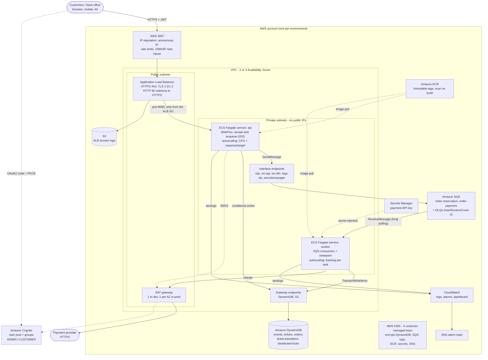

# ms-ticket - AWS infrastructure (Terraform)

Production-grade, cloud-native infrastructure for the reactive ticketing platform:
**ECS Fargate** (one image, two services: `api` and `worker`), **DynamoDB** (conditional
transactions), **SQS** (load leveling + DLQs), **ALB + WAF** at the edge, **Cognito** as the
identity provider, customer-managed **KMS** keys everywhere, and **CloudWatch** alarms,
dashboard and budgets. Nothing here needs to be clicked in the console.

```
infra/terraform/
├── modules/
│   ├── network/        VPC 2-3 AZ, public/private subnets, NAT (1 or per AZ), VPC endpoints, flow logs
│   ├── kms/            CMKs (dynamodb, sqs, logs, platform) with rotation and service-scoped key policies
│   ├── dynamodb/       the 5 tables of implementation-spec §6.1, GSIs, PITR, SSE-KMS, TTL, contributor insights
│   ├── sqs/            order-reservation / order-payment + one DLQ each, KMS, TLS-only queue policies
│   ├── ecr/            immutable tags, scan on push, KMS, lifecycle policy
│   ├── alb_waf/        internet-facing ALB (TLS 1.3/1.2), HTTP->HTTPS, access logs bucket, WAFv2 + logging
│   ├── ecs_cluster/    Fargate / Fargate Spot cluster, Container Insights, audited ECS Exec
│   ├── ecs_service/    reusable hardened Fargate service (instantiated as "api" and "worker")
│   ├── auth/           Cognito user pool, ADMIN/CUSTOMER groups, resource server, PKCE web client
│   └── observability/  log groups, SNS alarm topic, alarms, dashboard, AWS Budget
├── envs/
│   ├── dev/            backend.tf, providers.tf, main.tf, iam.tf, variables.tf, terraform.tfvars, outputs.tf, tests/
│   └── prod/           same files; only terraform.tfvars and the backend key differ
├── scripts/validate.sh fmt + validate + offline tests + tflint + checkov (Docker, no AWS credentials)
└── .tflint.hcl
```

---

## 1. Architecture



Request path: the API only validates, writes the order (`QUEUED`, idempotent `orderId`) and
publishes to SQS. The worker does the contended work (DynamoDB transactions with conditions) at a
bounded concurrency. Spikes become queue depth, and queue depth drives worker autoscaling, instead
of timeouts.

### 1.1 Networking

| Decision | Why |
|---|---|
| Public subnets only hold the ALB and NAT gateways (`map_public_ip_on_launch = false`) | Tasks are never directly reachable from the internet |
| Private subnets of a `/18` each (for a `/16`) | Fargate uses one ENI/IP per task, so autoscaling never runs out of IPs |
| **DynamoDB + S3 gateway endpoints** (free) | All table traffic and ECR image layers bypass the NAT: no data-processing charge, no internet path |
| Interface endpoints (private DNS) for SQS, ECR, Logs, STS, Secrets Manager | AWS API traffic stays on the AWS network; works even if NAT is down |
| Endpoint policies: DynamoDB only for **this account's** tables and principals; S3 only for this account's buckets plus the ECR layer bucket | Data perimeter: stolen credentials cannot exfiltrate to a foreign table or bucket through the VPC |
| NAT: `single_nat_gateway = true` in dev, one per AZ in prod | dev saves one NAT per extra AZ (~$33/month each); prod has no cross-AZ egress dependency |
| `availability_zones` pinned, validated with a `zone-name` filter | The network never changes on its own when AWS adds an AZ |
| Default security group stripped of all rules | Nothing can accidentally use it |
| VPC flow logs (ALL traffic) to a KMS-encrypted log group | Network forensics; retention per environment |

---

## 2. Security

### 2.1 Identity and access (least privilege)

* **No long-lived credentials anywhere.** Tasks use IAM **task roles**; the AWS SDK picks them
  up through `DefaultCredentialsProvider`. CI should assume a deploy role through GitHub OIDC.
* **One execution role and one task role per service** (no shared roles, no AWS-managed wildcard
  policies). Trust policies carry `aws:SourceAccount` / `aws:SourceArn` (confused-deputy protection).
* Application permissions (`envs/*/iam.tf`) are derived from the data access in the
  implementation spec and scoped to **table and index ARNs**:

| | api | worker |
|---|---|---|
| events | Get/Put/Update/ConditionCheck, Query `status-eventDate-index` | Get/Update/ConditionCheck |
| tickets | Get/BatchGet/BatchWrite (ticket pre-generation)/Update/ConditionCheck | Get/BatchGet/Update/ConditionCheck, Query `eventId-statusKey-index` |
| orders | Get/Put/Update/ConditionCheck | Get/Update/ConditionCheck, Query `deadline-index` |
| ticket-transitions | **PutItem + Query only** (append-only audit) | **PutItem only** |
| distributed-locks | - | Get/Put/Update/Delete (sweeper lease) |
| SQS | `SendMessage` to both queues | Receive/Delete/ChangeMessageVisibility/GetQueueAttributes on both, `SendMessage` to order-reservation (republish) |
| KMS | SQS and DynamoDB keys, **only through** `kms:ViaService` | same |
| Secrets Manager | - | payment API key (via execution role) |

  `TransactWriteItems` is not an IAM action: DynamoDB authorizes each item of a transaction with
  its own action (`UpdateItem`/`PutItem`/`ConditionCheckItem`). No principal can `DeleteItem` or
  `UpdateItem` an audit record, so the ticket history cannot be rewritten by the application.
* `allowed_account_ids` in the provider stops a `terraform apply` with the wrong credentials, for
  example dev code against the prod account.

### 2.2 Encryption

| Key (`alias/<project>-<env>-*`) | Protects | Who can use it |
|---|---|---|
| `dynamodb` | tables, PITR backups | IAM principals of the account **only via** `dynamodb.<region>.amazonaws.com` |
| `sqs` | queues and DLQs | only via `sqs.<region>.amazonaws.com` |
| `logs` | every log group (app, flow logs, WAF, ECS Exec) | `logs.<region>.amazonaws.com`, limited by encryption context to this account's log groups |
| `platform` | ECR images, Secrets Manager, SNS alarm topic | via `ecr` / `secretsmanager` / `sns`; `cloudwatch.amazonaws.com` to publish alarms |

All keys rotate automatically. Key administration (no crypto use) defaults to the account root,
which delegates to IAM; set `key_administrator_arns` to restrict it to named roles. Grants are
only allowed when `kms:GrantIsForAWSResource = true`. In transit: TLS 1.3/1.2 at the ALB (HSTS
added by the listener), **queue, topic and bucket policies deny `aws:SecureTransport = false`**,
and the SDK always uses HTTPS (VPC endpoints).

### 2.3 Edge protection (WAF + ALB)

| # | Rule | Action |
|---|---|---|
| 0 | `AWSManagedRulesAmazonIpReputationList` | block known malicious IPs and botnets |
| 1 | `AWSManagedRulesAnonymousIpList` | block hosting-provider IPs (where scalper bots run); VPN/Tor only **counted** (configurable) |
| 2 | Rate limit per IP (`waf_rate_limit_per_ip` / 5 min) | 429 in RFC 9457 shape |
| 3 | **Stricter rate limit on `POST /api/v1/events/*/orders`** (URL-decoded and path-normalized before matching) | 429, anti-bot / anti-scalping for ticket drops |
| 4 | `AWSManagedRulesCommonRuleSet` (OWASP top 10) | block |
| 5 | `AWSManagedRulesKnownBadInputsRuleSet` (Log4Shell and similar) | block |

WAF logs go to CloudWatch with `Authorization` and `Cookie` **redacted**, keeping only BLOCK/COUNT
events (cost). The in-app per-customer limiter (Bucket4j) still applies behind the WAF.
The ALB drops invalid headers, uses `defensive` desync mitigation, hides the `Server` header, adds
HSTS/nosniff/frame-deny, and answers **404 for `/actuator/**`**: Prometheus metrics and health
endpoints are only reachable from inside the VPC (the ALB health check calls the targets directly).

### 2.4 Workload hardening (ECS)

* Private subnets, `assign_public_ip = false`; the **api SG accepts traffic only from the ALB SG**;
  the **worker has no ingress rule at all**; egress is 443 only.
* Container: **non-root** (`user = 10001:10001`), **read-only root filesystem** with an ephemeral
  task volume on `/tmp` (Fargate has no tmpfs), **all Linux capabilities dropped**, init process,
  no privileged mode, `awslogs` in non-blocking mode (a log back-pressure never blocks the event loop).
* Secrets are injected by ECS from Secrets Manager (`valueFrom`) and never stored in the task
  definition or the state. The Terraform-managed version is a placeholder ignored afterwards; the real
  value is set out-of-band.
* ECR: **immutable tags** (a tag means one build, e.g. the git SHA), **scan on push**, KMS. The
  `image` variable rejects `:latest`.
* **ECS Exec is disabled in prod** (enforced by a cross-variable validation); in dev, sessions
  are recorded in a KMS-encrypted log group.

### 2.5 Identity provider (Cognito)

* Strong password policy (12+ characters, all character classes, history of 5), TOTP MFA
  (`OPTIONAL` or `ON`), e-mail as username, no user-existence leaks, token revocation,
  15-minute access tokens.
* **Threat protection** (advanced security `ENFORCED`, Plus tier) in prod: compromised-credential
  checks and adaptive MFA on risky sign-ins. dev uses the Essentials tier (cheaper).
* Groups **`ADMIN`** and **`CUSTOMER`**, resource server **`ms-ticket`** with scopes
  `orders.read`, `orders.write`, `events.admin`, and a public **authorization code + PKCE** client
  (no client secret in a browser).
* **How the API gets the `roles` claim.** Cognito puts group membership into the
  **`cognito:groups`** claim, so the simplest mapping, used here, is
  `TICKETING_SECURITY_ROLESCLAIM=cognito:groups` (`["ADMIN"]` becomes `ROLE_ADMIN`). An alternative is a
  **pre-token-generation Lambda (V2 trigger)** that copies the groups into a custom `roles` claim
  (no app change, one more component to run).
* **Audience.** Cognito *access* tokens have no `aud` claim. They carry `client_id` (the app
  client) and `scope` (`ms-ticket/...`). The infrastructure injects the client id as
  `TICKETING_SECURITY_AUDIENCE`, and the API's audience validator must accept `aud` **or**
  `client_id` (ID tokens do carry `aud = client id`). Issuer (`iss`) and signature (JWKS)
  validation are unchanged.

### 2.6 Environment isolation and governance

* **Separate state per environment** (`envs/dev`, `envs/prod`, different backend keys and
  buckets): a `terraform destroy` in dev cannot touch prod, and plans stay small.
* **Recommended: one AWS account per environment** under AWS Organizations (e.g.
  `ms-ticket-dev`, `ms-ticket-prod`, plus a `shared-services` account for ECR/CI and a `log-archive`
  account). Suggested SCPs on the workload OU:
  deny leaving the organization, deny disabling CloudTrail/GuardDuty/Config,
  deny `kms:ScheduleKeyDeletion` and `dynamodb:DeleteTable` outside the break-glass role,
  deny regions other than the approved ones (`aws:RequestedRegion`), deny IAM user and access key
  creation, and require IMDSv2 / encryption-on-create.
* `default_tags` on every resource: `Project`, `Environment`, `Owner`, `CostCenter`,
  `ManagedBy=terraform`, `Repository` (cost allocation and ownership).
* Deletion protection in prod: DynamoDB, ALB, Cognito user pool, log groups. Longest KMS and
  secret recovery windows. `allow_destroy_with_data` cannot be `true` in prod.
* Static checks: `terraform fmt`, `validate`, offline `terraform test`, `tflint` (terraform and AWS
  rulesets) and `checkov` (431 checks pass; each skip is explained inline with
  `#checkov:skip=<id>:<reason>`).

---

## 3. Scalability and resilience

| Concern | Mechanism |
|---|---|
| Traffic spikes on the API | Target tracking on **CPU** and **ALBRequestCountPerTarget**; `least_outstanding_requests` balancing (good for long SSE streams); ALB idle timeout 120 s |
| Queue backlog | Worker target tracking on a **metric-math "backlog per task"**: `(Visible(order-reservation) + Visible(order-payment)) / RunningTaskCount` (Container Insights). Target = acceptable latency / processing time per message |
| Bounds | `min_capacity`/`max_capacity` per service (also a cost ceiling); worker `min >= 1` because the sweepers run there |
| Spot interruptions | Worker burst capacity on **FARGATE_SPOT** (prod: 2 on-demand base + 1:3 on-demand:Spot). A SIGTERM drains in-flight messages (`stopTimeout` 60 s); unacknowledged messages are redelivered to idempotent consumers |
| Bad deployments | **Deployment circuit breaker with rollback** + **CloudWatch alarm rollback** (5xx rate and p99 latency alarms) for the API; 100/200 % rolling deployments |
| AZ failure | 3 AZs in prod, one NAT per AZ, AZ rebalancing of tasks, interface endpoints in every AZ |
| Poison messages | `maxReceiveCount = 5` then DLQ (14 days retention) with an alarm; `redrive_allow_policy` ties each DLQ to its queue |
| Data protection | PITR (35 days in prod), deletion protection, versioned log bucket |
| DynamoDB hot keys | On-demand capacity; Contributor Insights on events/tickets/orders and their GSIs to identify hot partitions (for example a sold-out event's counter item) |

Known limit, documented in the app ADRs: one event item takes **every** reservation of that
event. A transaction write costs 2 WCU on it, and a single partition sustains about 1,000 WCU/s,
so the limit is about 500 reservations per second per event. The next step is sharded
inventory counters. A virtual waiting room (CloudFront + admission token) in front of the API
would handle mega-drops.

---

## 4. Cost considerations

| Lever | Choice | Rationale |
|---|---|---|
| DynamoDB capacity | **On-demand (PAY_PER_REQUEST)** | Ticket drops are spiky and unpredictable; no capacity planning and no throttling while scaling. Switch the hot tables to **provisioned + autoscaling** (or reserved capacity) once the baseline is steady and predictable |
| DynamoDB transactions | Budget **2x WCU** per transactional item | A reservation of *q* tickets writes `2q + 2` items (event, tickets, order, audit records), each billed twice (prepare + commit): q = 2 costs 12 WRU (items < 1 KB). Hence KEYS_ONLY on the tickets GSI (cheaper index writes) and a sparse deadline index |
| DynamoDB cost breaker (dev) | `max_on_demand_throughput` per table | A runaway load test cannot burn the budget |
| NAT vs VPC endpoints | Gateway endpoints for DynamoDB and S3 (**free**) | The heaviest traffic (tables and image layers) never pays the NAT data-processing charge (~$0.045/GB) |
| Interface endpoints | dev: 1 AZ (`interface_endpoint_az_count = 1`), prod: every AZ | Each endpoint costs about $7.3 per AZ per month; dev saves about 2/3 |
| NAT gateways | dev: one shared; prod: one per AZ | About $33/month each plus data processing |
| Compute | **Fargate Spot** (up to ~70 % cheaper) for everything in dev and for worker burst in prod; `cpu_architecture = "ARM64"` (Graviton, ~20 % cheaper) once the image is multi-arch | |
| Logs | Retention 7-30 days in dev, 365 in prod; WAF logs keep only BLOCK/COUNT; flow-log aggregation 10 min | CloudWatch Logs ingestion (~$0.50/GB) is often the hidden cost |
| Contributor Insights | `THROTTLED_KEYS` mode in dev, full in prod | |
| KMS | 4 keys (about $4/month) instead of one per resource; SQS data-key reuse 5 min | Cuts KMS request volume |
| Governance | **AWS Budget** per environment (e-mail at 80 % actual, 100 % forecast) + `CostCenter` tag | |

Indicative idle baseline (us-east-1 list prices; check with the AWS Pricing Calculator):
**dev ≈ $120-150/month** (NAT, 6 endpoints x 1 AZ, ALB, WAF, KMS, 2 small Spot tasks),
**prod ≈ $450-550/month before traffic** (3 NAT, 6 endpoints x 3 AZ, ALB, WAF, 5 on-demand
1 vCPU/2 GB tasks), plus per-request charges (DynamoDB, SQS, WAF, ALB LCU) and Cognito MAUs.

---

## 5. Observability

* **Logs:** `/ecs/<project>-<env>/{api,worker}` (structured JSON from Spring Boot), flow logs,
  WAF logs, ECS Exec audit. All KMS-encrypted with bounded retention; deletion-protected in prod.
* **Metrics:** Container Insights (enhanced in prod), ALB/SQS/DynamoDB/WAF metrics, and a
  log-derived business metric `PaymentCapturedForReleasedOrder`. The application's Micrometer
  metrics (`/actuator/prometheus`) can be scraped by Amazon Managed Prometheus / ADOT inside the VPC.
* **Alarms to SNS** (KMS-encrypted topic; subscribe e-mail, PagerDuty or Chatbot):

| Alarm | Signal |
|---|---|
| `*-dlq-not-empty` | DLQ `ApproximateNumberOfMessagesVisible > 0`: poison message |
| `*-oldest-message-age` | `ApproximateAgeOfOldestMessage > 300 s`: workers stuck or at max capacity |
| `alb-5xx-rate` | `(target 5xx + ELB 5xx) / requests > 5 %` (metric math, ignores < 20 req/min). **Rolls back API deployments** |
| `api-p99-latency` | `TargetResponseTime p99 > 1 s`. **Rolls back API deployments** |
| `api-no-healthy-targets` | `HealthyHostCount < 1` |
| `ddb-*-throttled-requests` / `ddb-*-system-errors` | Metrics Insights `SUM(ThrottledRequests)` / `SUM(SystemErrors)` across all operations of each table |
| `*-cpu-high` / `*-memory-high` | ECS service average > 85 % for 8 of 10 minutes |
| `payment-captured-for-released-order` | log metric filter: a payment needs a manual refund |

* **Dashboard** `<project>-<env>`: edge (requests, 4xx/5xx, p50/p95/p99, WAF allowed/blocked),
  queues (backlog, in flight, age, DLQs), ECS (CPU, memory, running tasks) and DynamoDB (WCU/RCU,
  transaction conflicts, throttles).
* Tracing: the app propagates W3C `traceparent` (also through SQS attributes). Adding the ADOT
  collector as a sidecar sends traces to X-Ray without code changes.

---

## 6. Application contract

The task definitions inject configuration with Spring Boot **relaxed binding** names
(implementation-spec §8). OS environment variables override `application-prod.yml`:

| Variable | Value |
|---|---|
| `SPRING_PROFILES_ACTIVE` | `prod` |
| `TICKETING_RUNTIME_MODE` and `TICKETING_RUNTIMEMODE` | `api` or `worker` (ADR-008: one image, two services) |
| `AWS_REGION` | region |
| `AWS_DYNAMODB_TABLES_{EVENTS,TICKETS,ORDERS,TICKETTRANSITIONS,DISTRIBUTEDLOCKS}` | `<project>-<env>-<table>` |
| `AWS_SQS_ORDERRESERVATIONQUEUE`, `AWS_SQS_ORDERPAYMENTQUEUE` | `<project>-<env>-order-reservation` / `-order-payment` |
| `TICKETING_MIGRATIONS_ENABLED` | `false` (Terraform owns the schema in AWS) |
| `TICKETING_SECURITY_ISSUER`, `SPRING_SECURITY_OAUTH2_RESOURCESERVER_JWT_JWKSETURI` | Cognito issuer and JWKS URI |
| `TICKETING_SECURITY_AUDIENCE`, `TICKETING_SECURITY_ROLESCLAIM` | Cognito app client id, `cognito:groups` |
| `TICKETING_PAYMENT_BASEURL` | payment provider URL |
| `TICKETING_PAYMENT_APIKEY` (worker only) | from Secrets Manager, JSON key `apiKey` |
| `JAVA_TOOL_OPTIONS` | `-XX:MaxRAMPercentage=75 -XX:+ExitOnOutOfMemoryError` |

The DynamoDB tables mirror `src/main/resources/db/migrations` attribute by attribute (keys,
`status-eventDate-index`, `eventId-statusKey-index` KEYS_ONLY, sparse `deadline-index`, TTL on
`distributed-locks.expiresAt`). `schema-migrations` is not created in AWS. The offline tests
(`envs/*/tests/offline.tftest.hcl`) assert these names.

---

## 7. How to use

### Prerequisites
Terraform >= 1.10 (or Docker), AWS credentials for the **target account** (SSO / assumed role), an
ACM certificate in the region, and an S3 state bucket per account (versioned, Block Public
Access, TLS-only policy).

### First deployment (per environment)
```bash
cd infra/terraform/envs/dev
cp backend.hcl.example backend.hcl            # state bucket of this account
# edit terraform.tfvars: allowed_account_ids, certificate_arn, e-mails, URLs
terraform init -backend-config=backend.hcl

# 1) Registry first: the services need an image to start.
terraform apply -target=module.ecr
aws ecr get-login-password | docker login --username AWS --password-stdin <account>.dkr.ecr.<region>.amazonaws.com
docker build -t <repository_url>:$(git rev-parse --short HEAD) ../../../..
docker push <repository_url>:$(git rev-parse --short HEAD)

# 2) Everything else.
terraform plan  -var image_tag=$(git rev-parse --short HEAD) -out=tfplan
terraform apply tfplan

# 3) Real secret value (never in Terraform):
aws secretsmanager put-secret-value --secret-id "$(terraform output -raw payment_gateway_secret_arn)" \
  --secret-string '{"apiKey":"..."}'
```

### Day-2
* **Deploy a new version:** `terraform apply -var image_tag=<git sha>` (rolling, circuit breaker
  and alarm-based rollback). Promote to prod **the same tag that was tested in dev**.
* **Change sizing or limits:** edit `terraform.tfvars` and run plan/apply. Keep `main.tf`, `iam.tf`
  and `variables.tf` identical between environments (`diff -r envs/dev envs/prod` must only show
  tfvars, tests and backend key).
* **Redrive a DLQ** after fixing the cause: `aws sqs start-message-move-task --source-arn <dlq arn>`.

### Static validation (no AWS credentials)
```bash
infra/terraform/scripts/validate.sh
```
This runs `terraform fmt -check`, then for each environment `init -backend=false`, `validate`
and **`terraform test`** (mocked AWS provider: evaluates every module, validation and condition with
the real tfvars), then `tflint` and `checkov`, all in Docker. The same script is meant for CI.

---

## 8. Next steps (not implemented on purpose)

* Route 53 alias and ACM certificate (DNS validation) when the hosted zone is known.
* Transactional outbox: DynamoDB Streams + EventBridge Pipes (replaces the republish sweeper).
* Fargate ephemeral storage encrypted with a CMK, WAF Bot Control / ATP for login, Shield Advanced
  for large public drops.
* A shared-services account with a single ECR (cross-account pull) and image signing (Notation /
  Signer) verified at deploy time.
* Native ECS blue/green or canary deployments with test listeners.
